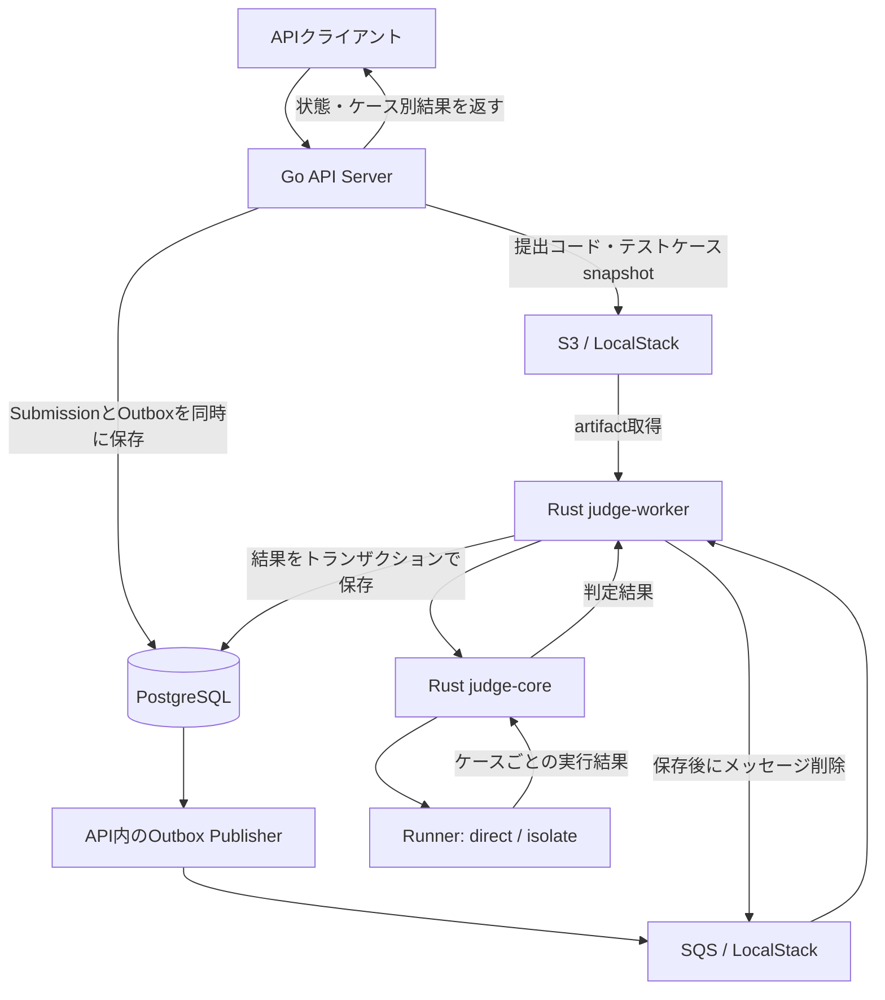

# Tag Judge

Pythonの提出コードを複数のテストケースで判定する、オンラインジャッジ基盤です。GoのHTTP APIが提出を受け付け、SQSを介してRustのWorkerが非同期に実行し、判定結果をPostgreSQLへ保存します。

このREADMEは、現在のmainブランチにある実装を説明します。中心となる設計は、**提出受付・ジョブ配送・コード実行・結果保存を分離し、障害や重複配送があっても提出結果を安全に確定すること**です。

## 現在の機能

- 公開問題の一覧・詳細取得、問題とテストケースの作成・更新・削除
- Pythonの提出受付、提出一覧・詳細・ケース別結果の取得
- Google OAuthとセッションCookieによる認証、ユーザーの役割に基づく認可
- グループの作成・取得・メンバー追加
- 任意の標準入力で実行するCodeRun APIの受付・取得

Submissionの判定経路はWorkerまで実装されています。CodeRunはAPIから実行ジョブを送信できますが、現在のRust WorkerはSubmission用のproblem実行に対応しており、CodeRunの実行・結果保存は未対応です。フロントエンドはmainには含まれていません。

## 全体構成



| コンポーネント | 役割 |
| --- | --- |
| `backend/` | HTTP API、認証・認可、問題管理、提出保存、Outboxの発行 |
| `judge/worker/` | SQS受信、S3取得、core呼び出し、得点計算、DBへの結果保存 |
| `judge/core/` | ケースの実行、時間制限の判定、出力比較、verdict生成 |
| PostgreSQL | ユーザー・問題・テストケース・提出・Outbox・判定結果の永続化 |
| S3 | 提出コードと不変なテストケースartifactの保存 |
| SQS | 提出受付と判定実行の間の待ち行列。失敗ジョブはDLQへ移動 |

ローカルではPostgreSQL 16とLocalStackのS3/SQSをDocker Composeで起動し、Go APIとRust Workerをホスト上で実行します。AWSの開発用Terraformには、S3・SQS・DLQ・EC2 Workerなどの定義があります。APIやDBを含むシステム全体のデプロイを一括で完成させる構成ではありません。

## ジャッジの設計

### coreとworkerを分ける

`judge-core`は`sourceCode`、`testCases`、`language`、`timeLimitMs`を受け取り、`JudgeResult`を返すライブラリ兼CLIです。S3、SQS、DB、ユーザーIDを扱いません。実行プロセスを起動するため、副作用のない関数という意味での「純粋」なコアではありませんが、インフラから独立した判定エンジンとして扱えます。

`judge-worker`は、ジョブのキーから実体を取得し、coreの`caseIndex`をartifact内の`testCaseId`へ対応付けて保存します。得点の計算もworkerの責務です。これにより、判定規則のテストと配送・永続化のテストを分けられます。

境界は次のインターフェースで表現しています。

| 境界 | インターフェース | 具体実装 |
| --- | --- | --- |
| APIからのartifact保存 | `SourceCodeStorage` / `TestCaseArtifactStorage` | ローカルファイル、S3 |
| APIからのジョブ送信 | `ExecutionDispatcher` | ログ出力、SQS |
| Workerのartifact取得 | `ArtifactStore` | S3。テストでは代替実装を注入 |
| Workerの状態・結果保存 | `ResultSink` | PostgreSQL |
| coreのコード実行 | `Runner` | `DirectRunner` / `IsolateRunner` |

APIのusecaseはrepositoryのインターフェースへ依存し、HTTP・PostgreSQL・AWSの具体実装は外側で組み立てます。Workerも`Runner`や`ResultSink`を差し替えて検証できます。

### 提出から判定確定まで

1. APIが認証・入力・公開問題へのアクセスを検証する。問題に有効な`current_test_cases_key`がなければ提出を拒否する。
2. 提出コードを一意なキーでstorageへ保存する。
3. `pending`のSubmissionと、判定ジョブを含む`submission_job_outbox`を**同じDBトランザクション**で保存する。提出には、その時点のテストケースキーとジョブ用の時間制限を固定する。
4. API内のPublisherがOutboxを読み、SQSへ送信する。成功した場合だけ`dispatched_at`を更新する。
5. WorkerがSQSから1件取得し、終端状態の提出なら実行を省略する。それ以外は`running`へ更新する。
6. S3から提出コードとテストケースsnapshotを読み、coreで判定する。
7. ケース別結果、全体status、score、`judged_at`を1つのDBトランザクションで確定する。
8. **DBへの保存が成功した後に**SQSメッセージを削除する。クライアントは提出詳細APIをポーリングして結果を取得する。

状態は次のように遷移します。coreのverdictは大文字、DB/APIのstatusは小文字です。

```text
pending → running → ac / wa / tle / re / ie
```

`ce`・`mle`はDBの状態として用意されていますが、現在のPython判定では専用の分類を実装していません。

### OutboxでDBとQueueの間の取りこぼしを防ぐ

DB保存とSQS送信は別のサービスへの操作なので、単純に順番に実行すると「提出は保存できたが、ジョブを送れなかった」という状態が残ります。

現在はSubmissionとOutboxを同時にコミットし、Publisherが未送信ジョブを継続して発行します。送信失敗時は`attempts`、`last_error`、`available_at`を更新し、1秒から最大64秒の指数バックオフで再試行します。Publisherは1秒ごとに動き、1回あたり最大16件を処理します。取得には`FOR UPDATE SKIP LOCKED`を使います。

送信成功直後、`dispatched_at`を保存する前に停止すると、同じジョブが再送されます。そのため、配送を一度きりにする保証には頼らず、結果保存側を冪等にしています。HTTPの提出作成API自体には冪等キーがないため、POSTの再試行は別のSubmissionを作る可能性があります。

### テストケースをsnapshotとして固定する

テストケースを作成・更新・削除すると、現在のケース一覧をJSON artifactとして保存し、問題の`current_test_cases_key`を更新します。キーは内容のSHA-256から生成します。

```text
problems/{problem_id}/testcases/{sha256}.json
```

artifactには`input`、`expectedOutput`、`testCaseId`、`score`を含めます。提出時はこのキーをSubmissionとOutboxにコピーするため、待ち行列にいる間に問題が編集されても、判定する入力・期待出力・配点は変わりません。提出ごとに全テストケースを再生成する必要もありません。

ただし、結果保存時には元の`test_cases`行の存在と問題への所属を検証しています。snapshotだけでケース削除後の保存まで完結する設計ではありません。また、テストケース変更・artifact保存・問題のキー更新はサービスをまたぐ単一トランザクションではないため、更新途中の失敗への整合性回復や古いartifactの削除方針は今後の課題です。

### 重複配送と長時間実行

Workerは開始時と結果保存時にSubmissionを行ロックし、すでに終端状態なら処理を省略します。ケース結果には`(submission_id, test_case_id)`の一意制約があり、結果保存と終端状態への更新を同じトランザクションで行います。

`running`のジョブは再処理を許可するため、障害復旧時に再実行できます。同時に届いたジョブによるコード実行そのものを完全に一度へ制限する仕組みではありません。重複実行が起きても、先に確定した終端結果を後続が上書きしない設計です。

SQS受信は最大20秒のlong pollingで1件ずつ行います。実行中は10秒ごとにvisibility timeoutを30秒へ延長します。延長に失敗しても処理は継続し、再配送された場合はDB側の冪等性で結果を保護します。ローカルのQueue定義は`maxReceiveCount=3`でDLQへ移動する設定です。

### 提出の失敗と基盤障害を分ける

| 状況 | 現在の扱い |
| --- | --- |
| 出力不一致、時間超過、Python例外 | `WA` / `TLE` / `RE`を保存し、メッセージを削除 |
| 不正なartifact JSON、空のケース、不正なケースIDや配点 | 入力が壊れているため`IE`として確定し、保存後に削除 |
| S3取得失敗、DB接続・保存失敗 | エラーを返し、メッセージを削除しない。visibility timeout後に再配送可能 |
| Runner内部の失敗 | coreが`IE`を返す。すべての基盤障害が再試行対象になるわけではない |

現在のWorkerは、ジョブ処理のエラーが上位へ返るとプロセスを終了します。SQSにメッセージが残ることと、Workerが自動再起動することは別なので、継続運用ではプロセス監督が必要です。DLQからの再投入や、DLQ移動時にSubmissionを終端状態へ変える処理は未実装です。

## 判定ルールと実行環境

### ケースごとの判定

ケースを順番に実行し、最初の非ACで打ち切ります。例えば`AC → WA`なら、後続ケースを実行せず全体を`WA`にします。全ケースACの場合だけartifactの配点合計を付与し、それ以外は0点です。

| Verdict | 条件 |
| --- | --- |
| `TLE` | Runnerが時間超過を検出 |
| `RE` | Pythonプロセスが正常終了しない。構文エラーも含む |
| `WA` | 正常終了したが標準出力が期待出力と不一致 |
| `AC` | 正常終了し、標準出力が期待出力と一致 |
| `IE` | coreやRunner内部のエラー、判定入力の不備 |

出力比較は`actual.trim_end() == expected.trim_end()`です。文字列末尾の空白・改行を無視し、先頭や途中の空白は区別します。Special Judge、浮動小数点の許容誤差、インタラクティブ問題、部分点には対応していません。

### Runnerで実行方式を分離する

`Runner`は実行成功・タイムアウト・実行時間・stdout・stderrを返し、coreがそこから判定を作ります。OSごとの既定値は次のとおりです。

| 環境 | Runner | 動作 |
| --- | --- | --- |
| Linux | `IsolateRunner` | `isolate --cg`でPythonを実行。CPU時間とwall timeを制限 |
| macOSなどLinux以外 | `DirectRunner` | 一時ファイルのPythonを直接実行し、時間超過時に子プロセスをkill |

isolateではCPU時間を`timeLimitMs`、wall timeをそれに1秒加えた値に設定します。cgroupメモリ制限は固定の262,144 KBで、問題の`memory_limit_kb`にはまだ連動していません。box IDはファイルロックで確保し、終了時にcleanupします。Linuxでは`isolate`とcgroupを利用できる実行環境が必要で、未導入時にdirectへ自動フォールバックしません。

DirectRunnerは開発用で、未信頼コードを隔離する仕組みを持ちません。また、現在は出力量の制限、厳密なMLE分類、メモリ使用量の記録、複数言語のコンパイル処理などは未実装です。

### 結果の公開範囲

`GET /api/v1/submissions/{submission_id}`は、提出者本人または管理者が取得できます。`pending` / `running`では`case_results: []`、完了後は実行済みケースのID・status・時間・メモリを返します。未実行ケースは含めず、現在は`memory_kb`が`null`になります。

DBにはstdout/stderrも保存しますが、隠しテストを保護するため、詳細APIでは入力・期待出力・stdout・stderrを管理者にも返しません。

## ローカルで動かす

必要なものはDocker Compose、Go（`backend/go.mod`に従う）、Rust stable（edition 2024対応）、Python 3、golang-migrateの`migrate`コマンドです。Linuxでジャッジを動かす場合はisolateも用意します。

### APIと外部依存の起動

リポジトリルートで実行します。既存の`.env`がある場合は上書きせず、`.env.example`との差分を反映してください。

```sh
cp .env.example .env
# .envの値を子プロセスにも渡す
set -a
. ./.env
set +a
export AWS_ACCESS_KEY_ID=test
export AWS_SECRET_ACCESS_KEY=test

docker compose up -d
# PostgreSQLとLocalStackがhealthyになったことを確認してから進む
docker compose ps
make migrate-up
make seed
make run-api
```

Makefileは`.env`を読みますが、すべての値を自動で子プロセスへexportするわけではありません。上記の読み込みは、AWS設定や開発用認証設定をAPIにも渡すために行います。

`.env.example`はLocalStackの`http://localhost:4566`を指定しています。APIはbucketとqueueが両方設定されている場合にS3/SQSを利用し、それ以外はファイル保存とログ出力を使います。ログ出力の場合、実際の判定ジョブはQueueへ送られません。

別のターミナルで、ルートから同じ環境設定を読み込み、Workerを起動します。

```sh
set -a
. ./.env
set +a
cargo run --manifest-path judge/worker/Cargo.toml
```

WorkerのDB接続先は`JUDGE_DATABASE_URL`、未設定時は`DATABASE_URL`です。APIとWorkerで同じDB・bucket・queueを指定します。

### 提出して確認する

開発用認証の`DEV_HEADER_AUTH=true`とseed済みユーザーを使った例です。本番では開発用ヘッダー認証を無効にし、OAuth/セッション認証を利用します。

seedはSQLで直接テストケースを登録するため、APIのsnapshot更新処理を通りません。最初に既存ケースを更新し、`current_test_cases_key`を生成します。

```sh
curl -sS -X PATCH http://localhost:8080/api/v1/problems/1/test-cases/1 \
  -H 'Content-Type: application/json' \
  -H 'X-User-ID: 00000000-0000-4000-8000-000000000001' \
  -H 'X-User-Role: author' \
  -d '{"expected_output":"3\n"}'

curl -sS -X POST http://localhost:8080/api/v1/problems/1/submissions \
  -H 'Content-Type: application/json' \
  -H 'X-User-ID: 00000000-0000-4000-8000-000000000001' \
  -H 'X-User-Role: author' \
  -d '{"language":"python","source_code":"print(sum(map(int, input().split())))"}'
```

作成レスポンスの`data.id`を指定して、完了まで詳細を取得します。

```sh
SUBMISSION_ID=1 # 作成レスポンスのIDへ置き換える
curl -sS "http://localhost:8080/api/v1/submissions/${SUBMISSION_ID}" \
  -H 'X-User-ID: 00000000-0000-4000-8000-000000000001' \
  -H 'X-User-Role: author'
```

### coreだけを試す

API・DB・S3・SQSを起動せず、同梱のリクエストJSONで判定できます。LinuxではこのCLIも既定でisolateを使います。

```sh
cd judge/core
cargo run -- examples/requests/ac.json
cargo run -- examples/requests/wa.json
cargo run -- examples/requests/tle.json
cargo run -- examples/requests/re.json
```

出力は全体の`verdict`、ケース別の`caseIndex`・`verdict`・`runtimeMs`・stdout/stderrなどを含むJSONです。

## テストとコードの入口

```sh
# Goのテスト
make test

# Rustのテスト
cargo test --manifest-path judge/core/Cargo.toml
cargo test --manifest-path judge/worker/Cargo.toml
```

提出詳細のPostgreSQL統合テストは`SUBMISSION_DETAILS_TEST_DATABASE_URL`を指定した場合に実行されます。CIでは専用のPostgreSQLサービスを用意して実行します。その他の統合テストの有効化条件は各テストファイルを参照してください。

| 読みたい内容 | 主なファイル |
| --- | --- |
| APIの組み立てとOutbox起動 | [backend/cmd/api/main.go](backend/cmd/api/main.go) |
| 提出受付と詳細取得 | [submission_usecase.go](backend/internal/usecase/submission_usecase.go) |
| テストケースsnapshot更新 | [test_case_usecase.go](backend/internal/usecase/test_case_usecase.go) |
| Submission＋Outboxの保存とPublisher | [submission_repository.go](backend/internal/infra/postgres/submission_repository.go) |
| Workerの判定と再試行エラーの区別 | [worker.rs](judge/worker/src/worker.rs) |
| Workerの状態遷移と結果保存 | [orchestrator.rs](judge/worker/src/orchestrator.rs)、[result_sink.rs](judge/worker/src/result_sink.rs) |
| 判定規則と実行方式 | [judge.rs](judge/core/src/judge.rs)、[runner/mod.rs](judge/core/src/runner/mod.rs) |
| HTTP APIの仕様 | [OpenAPI](backend/docs/openapi.yaml) |

関連資料は[ローカル開発](docs/local-development.md)、[Rust Judge設計方針](docs/rust-judge-design.md)、[judge-core要件](docs/judge-core-requirements.md)、[AWS開発環境](infra/aws/dev/README.md)、[Terraform CI/CD](docs/terraform-cicd.md)を参照してください。設計資料には初期構想も含まれるため、現在の動作はこのREADMEと実装を基準に確認してください。
