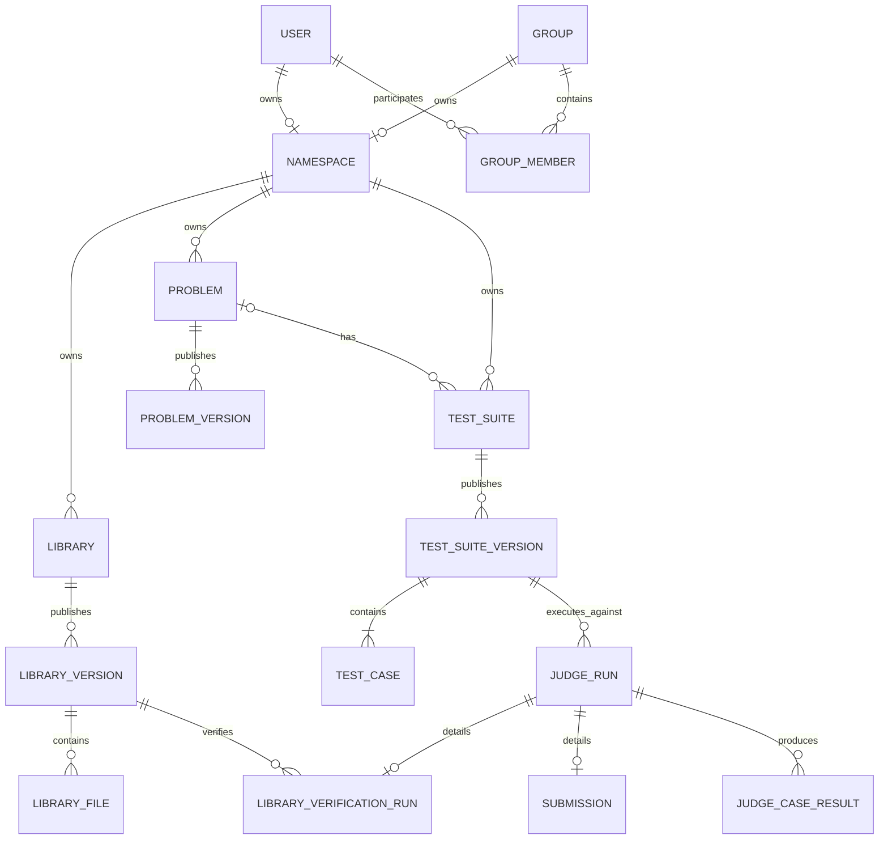

# ライブラリ共有ジャッジシステム 要件定義

> ⚠️ **この文書は初期構想の記録です（2026-11-10 失効）。現行仕様は [docs/library-sharing.md](../library-sharing.md) を参照してください。**
>
> 本書は「Library Version を Test Suite / adapter / Judge Run で検証し、verdict・ケース結果を保存・公開する」という初期構想の要件定義です。この検証モデルは採用せず、所有者が Version ごとに提出 URL を 1 件設定する方式に置き換えました。検証・判定に関する記述（§3、§10.5、§11、§12.2、§13.1、§15.1、§16、§17.2〜17.4、§18.3、§19）は歴史的なもので、実装の契約でも受け入れ条件でもありません。Namespace / Library / 不変 Version / ライセンスなど検証と無関係な部分は、将来構想として参考になります。

## 1. 本書の目的

本書は、現在のオンラインジャッジ基盤を、競技プログラミング向けのライブラリを公開・検証・再利用できる「ライブラリ共有ジャッジシステム」へ拡張するための要件を整理する。

実装仕様を確定する前に、次の認識を揃えることを目的とする。

- 何を公開するサービスなのか
- 通常のオンラインジャッジと何が異なるのか
- ライブラリ、問題、テストケースをどの単位で管理するのか
- 公開済みデータの変更と履歴をどう扱うのか
- 他の利用者によるフォークをどこまで許可するのか
- AIがどの範囲まで自動操作できるのか
- 現在のジャッジ基盤から何を残し、何を変更するのか

本書はプロダクト要件とシステム要件の境界を定める。個々のHTTP API、DB migration、画面レイアウト、S3オブジェクト形式などの詳細は、別途基本設計で定義する。

## 2. 背景

競技プログラミングでは、アルゴリズムやデータ構造を自分用のライブラリとして整備し、必要な場面で再利用することが一般的である。

一方で、競技規則に沿って外部コードや事前に用意したコードを利用するためには、コードの出典、公開状態、公開時点、変更履歴などを説明できることが重要になる。単にコードを保存するだけでは、次の情報が不足する。

- いつ、どの内容が公開されたか
- その版が後から書き換えられていないか
- どの問題やテストケースで検証されたか
- 誰が作成し、どこから派生したか
- どのライセンスで再利用できるか

本システムでは、ライブラリを不変なバージョンとして公開し、そのバージョンに対するジャッジ結果を紐付けることで、公開、検証、再利用を一体として扱う。

ただし、本システム上で公開されていることだけをもって、特定の競技やコンテストの規則に適合することを保証しない。利用者自身が参加する競技の最新規則を確認する必要がある。

## 3. プロダクトの定義

本システムを次のように定義する。

> 競技プログラミング用ライブラリを公開・検証・再利用・継承でき、人間とAIの双方が継続的に管理できるライブラリ共有ジャッジシステム

中心となる価値は、コードを掲載することではなく、特定のライブラリバージョンが特定のテストスイートバージョンで検証された事実を残せることにある。

```text
Library Version
    ×
Test Suite Version
    ↓
Judge Run
    ↓
Verdict / Case Results
```

## 4. 目標

### 4.1 プロダクト目標

- 利用者が自分の競技プログラミング用ライブラリを公開できる
- 公開された内容と公開日時を後から確認できる
- ライブラリの版ごとに検証結果を確認できる
- 他の利用者が公開ライブラリを発見し、利用方法を理解できる
- 公開が許可された問題やテストスイートをフォークできる
- フォーク元と変更履歴を追跡できる
- AIがAPIを通じてライブラリの整理、更新案作成、検証を行える
- AIによる変更を監査し、人間が公開前に確認できる

### 4.2 技術目標

- 現在のGo API、Rust Worker、judge-core、PostgreSQL、S3、SQSの責務分離を維持する
- 公開済みバージョンを不変にする
- 判定対象をIDではなく具体的なバージョンまで固定する
- Queueの重複配送が発生しても結果を安全に確定できる
- 非公開テストケースの内容をAPI利用者へ漏らさない
- 人間向けUIとAI向けAPIが同じドメインモデルを利用する

## 5. 対象外

初期段階では、次の機能を対象外とする。

- 特定の競技規則への適合を自動認定する機能
- GitHubなど外部サービスとの完全な双方向同期
- 任意のパッケージマネージャとしての配布機能
- C++を含む複数言語への同時対応
- インタラクティブ問題
- Special Judge
- 高度な部分点
- ライブラリの安全性や正しさを数学的に証明する機能
- AIが人間の確認なしに公開版を変更する機能
- 非公開または再配布が許可されていないテストケースのフォーク

## 6. 用語

| 用語 | 定義 |
| --- | --- |
| Library | ライブラリの論理的な単位。名前、説明、所有者、公開範囲などを持つ |
| Library Version | ある時点のライブラリ内容を固定した版 |
| Library File | Library Versionに含まれる個々のソースファイル |
| Problem | 問題の論理的な単位 |
| Problem Version | 問題文、制限時間、メモリ制限などを固定した版 |
| Test Suite | 一緒に実行するテストケース群の論理的な単位 |
| Test Suite Version | テストケースの内容と順序を固定した版 |
| Test Case | 入力、期待出力、配点などを持つ個別ケース |
| Verification Config | ライブラリをどのテストスイートで、どの入口から検証するかを定義した設定 |
| Judge Run | コードとテストスイートを固定して行う1回の判定 |
| Library Verification Run | Library Versionを対象にしたJudge Run |
| Submission | 利用者が問題を解くために提出するコード。Library Verificationとは区別する |
| Fork | 公開されたリソースを出典情報付きで複製し、別の所有者が変更可能にする操作 |
| Namespace | ユーザーまたはグループが所有する公開リソースの名前空間 |
| Draft | 編集可能だが公開されていないバージョン |
| Published | 公開済みで内容を変更できないバージョン |
| Yanked | 公開履歴を残したまま、新規利用を非推奨にしたバージョン |

## 7. 利用者

### 7.1 一般利用者

- 公開ライブラリ、問題、検証結果を閲覧する
- 自分のライブラリを作成する
- 自分のライブラリのドラフトを編集する
- ライブラリを検証し、公開する
- 利用可能な問題やテストスイートをフォークする

### 7.2 グループメンバー

- グループの権限に応じてリソースを閲覧・編集・公開する
- グループ所有ライブラリの検証を行う

### 7.3 管理者

- 規約違反や不正利用への対応を行う
- リソースの公開停止や調査を行う
- ジャッジ基盤の障害を調査する

管理者であっても、通常の公開APIから隠しテストケースの内容を取得できるようにはしない。運用調査に必要なアクセスは、一般APIとは別の管理経路で制御する。

### 7.4 AI・自動化クライアント

- API Tokenに付与されたscopeの範囲で操作する
- ライブラリのドラフトを作成する
- ファイルを追加・更新する
- 検証を開始し、結果を取得する
- Change Requestを作成する

初期方針では、AI・自動化クライアントに公開権限を与えない。公開操作は人間の承認を必要とする。

## 8. リソースの所有と公開範囲

### 8.1 所有単位

Library、Problem、Test SuiteはNamespaceに所属する。

```text
Namespace
- User Namespace
- Group Namespace
```

同じNamespace内では、リソースごとに一意なslugを持つ。

```text
/{namespace}/{resource-type}/{slug}
```

### 8.2 公開範囲

| 公開範囲 | 閲覧可能者 | 検索結果への表示 |
| --- | --- | --- |
| `public` | 全員 | 表示する |
| `unlisted` | URLを知っている利用者 | 原則表示しない |
| `private` | 所有者と許可されたメンバー | 表示しない |
| `group` | 対象グループのメンバー | 表示しない |

MVPでは`public`と`private`を必須とし、`unlisted`と`group`は段階的に対応してよい。

## 9. バージョン管理要件

### 9.1 共通規則

Library、Problem、Test Suiteは、論理リソースとバージョンを分離する。

```text
Library      → Library Version
Problem      → Problem Version
Test Suite   → Test Suite Version
```

公開済みバージョンは次の属性を満たす。

- 内容を更新できない
- 物理削除しない
- 公開日時を変更できない
- 内容のハッシュを保持する
- 作成者を保持する
- 派生元がある場合は派生元バージョンを保持する

### 9.2 状態遷移

```text
draft ──publish──> published ──yank──> yanked
  │
  └──delete──> deleted
```

- `draft`だけを編集・削除できる
- `published`から`draft`には戻さない
- `yanked`も履歴と既存の検証結果を保持する
- 公開済みの内容を修正する場合は、新しいバージョンを作成する

### 9.3 バージョン識別子

MVPでは、利用者が指定する表示用バージョンと、システム内部のIDを分離する。

```text
internal id : bigint
version     : text
```

表示用バージョンをSemantic Versioningへ強制するかは未決事項とする。ただし、同一リソース内で重複してはならない。

## 10. 機能要件

### 10.1 認証・プロフィール

| ID | 要件 |
| --- | --- |
| AUTH-01 | 利用者はGoogle OAuthでログインできる |
| AUTH-02 | 利用者は公開用の一意なhandleを持つ |
| AUTH-03 | 利用者はAPI Tokenを作成・失効できる |
| AUTH-04 | API Tokenには操作scopeと有効期限を設定できる |
| AUTH-05 | API Tokenの平文をDBへ保存しない |

### 10.2 Library

| ID | 要件 |
| --- | --- |
| LIB-01 | 利用者は自分または所属グループのNamespaceにLibraryを作成できる |
| LIB-02 | Libraryは名前、slug、説明、言語、公開範囲、ライセンスを持つ |
| LIB-03 | Libraryは複数のLibrary Versionを持てる |
| LIB-04 | 利用者はLibrary Versionをdraftとして作成できる |
| LIB-05 | Library Versionは複数ファイルを持てる |
| LIB-06 | ファイルは相対パス、内容ハッシュ、サイズ、言語を持つ |
| LIB-07 | draftのファイルは追加・更新・削除できる |
| LIB-08 | publishedのファイルは変更できない |
| LIB-09 | Library Versionは利用方法、entrypoint、依存関係などのmanifestを持てる |
| LIB-10 | Library Versionは内容全体のハッシュを持つ |
| LIB-11 | 公開時に公開日時と公開者を記録する |
| LIB-12 | 公開済みバージョンをyankできる |
| LIB-13 | yankedされたバージョンもURLと履歴を維持する |

### 10.3 Problem

| ID | 要件 |
| --- | --- |
| PRB-01 | 利用者はProblemを作成できる |
| PRB-02 | Problemは複数のProblem Versionを持てる |
| PRB-03 | Problem Versionは問題文、制限時間、メモリ制限を持つ |
| PRB-04 | publishedのProblem Versionは変更できない |
| PRB-05 | SubmissionとLibrary Verificationは具体的なProblem Versionを参照する |

### 10.4 Test Suite

| ID | 要件 |
| --- | --- |
| TST-01 | 利用者はTest Suiteを作成できる |
| TST-02 | Test SuiteはProblemに所属できるが、Library専用テストとして独立してもよい |
| TST-03 | Test Suiteは複数のTest Suite Versionを持てる |
| TST-04 | Test Suite Versionは順序付きのTest Caseを1件以上持つ |
| TST-05 | Test Caseは入力、期待出力、サンプル区分、配点を持つ |
| TST-06 | publishedのTest Suite Versionは変更できない |
| TST-07 | 隠しTest Caseの入力と期待出力を一般APIで返さない |
| TST-08 | 判定実行時はTest Suite Versionのartifactとハッシュを固定する |

### 10.5 Library Verification <!-- 失効: 2026-11-10 提出URL方式へ置き換え -->

> **失効:** この節の VER-01〜VER-10（Test Suite / Judge Run / verdict / ケース結果による検証）は旧方式の要件であり、現在の要件ではありません。現行は所有者による Version の提出URL（`submission_url`）の設定・削除のみです。[現行仕様](../library-sharing.md) を参照してください。

| ID | 要件 |
| --- | --- |
| VER-01 | 利用者はLibrary VersionをTest Suite Versionに対して検証できる |
| VER-02 | 検証時にLibrary Version、Test Suite Version、言語、実行制限を固定する |
| VER-03 | 検証用のentrypointまたはharnessを指定できる |
| VER-04 | WorkerはLibrary Fileとharnessを実行可能なworkspaceへ展開する |
| VER-05 | 判定結果として全体verdictとケース別結果を保存する |
| VER-06 | 同じLibrary Versionを複数のTest Suite Versionで検証できる |
| VER-07 | 同じ組み合わせを複数回再検証できる |
| VER-08 | 公開ページで直近の検証結果と対象バージョンを確認できる |
| VER-09 | 検証失敗時に、権限の範囲内で原因を確認できる |
| VER-10 | 隠しケースの入力、期待出力、実出力から秘密情報を推測できる情報を公開しない |

### 10.6 Submission

| ID | 要件 |
| --- | --- |
| SUB-01 | 現在の問題提出機能を維持する |
| SUB-02 | Submissionは具体的なProblem VersionとTest Suite Versionを参照する |
| SUB-03 | SubmissionとLibrary Verificationをドメイン上で区別する |
| SUB-04 | SubmissionとLibrary Verificationは共通のJudge Run基盤を利用できる |

### 10.7 Fork

| ID | 要件 |
| --- | --- |
| FRK-01 | publicかつフォーク可能なLibraryをフォークできる |
| FRK-02 | publicかつフォーク可能なProblemをフォークできる |
| FRK-03 | publicかつフォーク可能なTest Suiteをフォークできる |
| FRK-04 | フォーク時に元リソースと元バージョンを記録する |
| FRK-05 | フォーク後の変更は元リソースへ影響しない |
| FRK-06 | フォーク先に出典、作者、ライセンスを表示する |
| FRK-07 | private、group、または再配布不可のリソースを権限なしにフォークできない |
| FRK-08 | 元リソースがyankまたは非公開化されても、許可済みフォークの出典記録を保持する |

元リソースの削除要求とフォーク済みデータの扱いは、ライセンスおよび運用ポリシーと合わせて別途定義する。

### 10.8 AI・自動化

| ID | 要件 |
| --- | --- |
| AI-01 | AIクライアントはAPI Tokenで認証できる |
| AI-02 | APIからLibrary、Version、File、検証結果を構造化データとして取得できる |
| AI-03 | AIクライアントはdraftを作成・変更できる |
| AI-04 | AIクライアントは検証を開始し、完了状態を取得できる |
| AI-05 | AIクライアントはChange Requestを作成できる |
| AI-06 | 初期段階では人間だけがChange Requestを承認・公開できる |
| AI-07 | 操作者、認証Token、操作内容、対象リソースを監査ログへ記録する |
| AI-08 | 更新APIは可能な範囲で冪等キーまたは楽観的ロックを利用できる |
| AI-09 | APIはOpenAPIで操作、入力、出力、エラーを記述する |

### 10.9 検索・閲覧

| ID | 要件 |
| --- | --- |
| DSC-01 | publicなLibraryを一覧表示できる |
| DSC-02 | 名前、説明、言語、タグでLibraryを検索できる |
| DSC-03 | Libraryの公開バージョン一覧を確認できる |
| DSC-04 | バージョンごとのファイル一覧、ハッシュ、公開日時を確認できる |
| DSC-05 | バージョンごとの検証状態を確認できる |
| DSC-06 | フォーク元と派生先を確認できる |

検索の高度化はMVP後とし、MVPでは名前とslugによる取得を必須とする。

### 10.10 ライセンス・権利確認

AtCoderは特定のライセンスを指定していないが、ソースコードをコピーする利用者自身に、コピー、改変、提出などがライセンス上許可されているか確認する責任を求めている。ライセンス違反を理由にBANを行う場合があることも明記されている。

また、2026年10月14日版のABC、ARC、AGC向け生成AI利用ルールでは、コンテスト開始前に生成AIで作成されたコードを使用する場合、コードをコンテスト開始前からWeb上で公開し、提出コードへ参照URLを記載する必要がある。第三者がコード内容と事前公開のタイムスタンプを確認できなければならない。

参考:

- [AtCoder生成AI対策ルール - 20261014版](https://info.atcoder.jp/entry/llm-rules-ja)
- [コンテスト中のルールについて](https://info.atcoder.jp/overview/contest/rules)

本システムは、これらの確認に必要な情報を提供する。ただし、本システム上で公開されていることや特定のライセンスが選択されていることだけをもって、AtCoderを含む個別のコンテスト規則への適合を保証しない。

#### Library向けライセンス選択肢

初期UIでは、Library Versionのライセンスを次の3択に絞る。

| 選択肢 | 内部表現 | 用途 |
| --- | --- | --- |
| MIT | `MIT` | 標準かつ推奨。自由な利用、改変、再配布を想定する |
| Apache License 2.0 | `Apache-2.0` | 明示的な特許ライセンスも必要な場合に使用する |
| その他 | SPDX expressionまたは`LicenseRef-*` | 第三者コード、別のOSSライセンス、個別許諾を扱う |

`BSD-2-Clause`、`BSD-3-Clause`、`ISC`、`BSL-1.0`、`MPL-2.0`、`GPL-3.0-only`などは「その他」から指定する。

`GPL`などのコピーレフトライセンスは利用・改変・提出が一律に禁止されるものではないが、再配布時の義務がMITやApache-2.0より複雑である。そのため、主要な選択肢として前面には出さず、利用者自身による条件確認を必要とする。

ライセンス未指定または`All rights reserved`のコードは、閲覧用に公開できるとしても、他の利用者がコピー、改変、フォーク、AtCoderへの提出に利用できるLibraryとして扱わない。

#### コードの由来

ライセンスとは別に、公開者はLibrary Versionに含まれるコードの由来を次から選択する。

```text
original
  すべて自分または所属グループが権利を持つコード

third_party
  第三者コードを含み、ライセンスを確認したコード

permission
  権利者から個別に利用・再公開の許可を得たコード
```

`third_party`または`permission`の場合は、次の情報を必須とする。

```text
- 元コードのURL
- 作者または著作権者
- SPDX license expressionまたは個別許諾の説明
- 必要な著作権表示
- 必要なNOTICE
- 元コードから変更したかどうか
```

公開者は、AtCoderへの提出だけでなく、本システム上でコードを公開・再配布する権利も保有していることを確認しなければならない。

#### 公開証跡

Published Library Versionは、次の情報を変更不能な公開証跡として保持する。

```text
- permanent_url
- published_at
- content_sha256
- license_expression
- copyright_holder
- copyright_notice
- source_url
- attribution_text
- rights_basis
- rights_confirmed_by
- rights_confirmed_at
```

ライセンスも公開済みバージョンの一部として固定する。ライセンスを変更する場合は新しいLibrary Versionを公開する。

#### 提出コード用参照ヘッダー

本システムは、利用者が提出コードへコピーできる参照ヘッダーをLibrary Versionごとに生成する。

```cpp
// Library: UnionFind v1.2.0
// Source: https://example.com/@user/libraries/union-find/v1.2.0
// Published: 2026-10-01T12:00:00Z
// License: MIT
```

ヘッダーには少なくとも不変の公開URL、公開日時、ライセンスを含める。参照ヘッダーの挿入だけでライセンス条件や競技規則への適合を保証するものではない。

| ID | 要件 |
| --- | --- |
| LIC-01 | Library Versionのライセンス選択肢はMIT、Apache-2.0、その他の3つを基本とする |
| LIC-02 | 「その他」ではSPDX expressionまたは独自ライセンス識別子を保存できる |
| LIC-03 | 公開者はコードの由来をoriginal、third_party、permissionから選択する |
| LIC-04 | 第三者コードを含む場合は元コードURL、作者、ライセンスまたは許諾内容を必須とする |
| LIC-05 | 公開者は本システム上で公開・再配布する権利があることを確認する |
| LIC-06 | Published Library Versionのライセンスと権利情報を変更できない |
| LIC-07 | Library Versionの不変URL、公開日時、内容ハッシュを第三者が確認できる |
| LIC-08 | Library Versionごとに提出コード用参照ヘッダーを生成できる |
| LIC-09 | publicであることとコピー・フォーク可能であることを区別する |
| LIC-10 | ライセンス上許可されていないLibraryをフォークまたは再配布できない |

## 11. 判定要件

### 11.1 共通Judge Run

Submission、Library Verification、CodeRunは、実行要求として共通のJudge Runを利用する。

```text
Judge Run
- kind: submission | library_verification | code_run
- source artifact
- test suite version
- language
- execution limits
- status
- results
```

種別固有の情報は、SubmissionまたはLibrary Verification Runが保持する。

### 11.2 状態遷移

```text
pending → running → ac / wa / tle / mle / re / ce / ie
```

初期の実装対象は現行と同じく次の状態とする。

```text
ac / wa / tle / re / ie
```

`mle`と`ce`はDB上の状態として確保してもよいが、正確に分類できない間は返さない。

### 11.3 冪等性

- Queueは少なくとも1回配送される前提とする
- 同じJudge Runが重複配送されても終端結果を破壊しない
- ケース結果はJudge Runとcase indexの組み合わせで一意にする
- 結果保存と終端状態更新を同一DBトランザクションで行う
- DB保存に成功してからQueueメッセージを削除する
- Outboxを利用してDB保存とQueue送信の間の取りこぼしを防ぐ

### 11.4 artifact

次の実体は原則としてobject storageへ保存する。

- Library Versionのファイル
- 提出コード
- Test Suite Versionの入力と期待出力
- 検証用harness
- 必要に応じてstdoutとstderr

PostgreSQLには、artifact key、内容ハッシュ、サイズ、所有者、公開状態などのメタデータを保存する。

## 12. 権限要件

### 12.1 グループロール

| ロール | 閲覧 | draft編集 | 検証 | 公開 | メンバー管理 |
| --- | --- | --- | --- | --- | --- |
| `viewer` | 可 | 不可 | 不可 | 不可 | 不可 |
| `member` | 可 | 条件付き | 可 | 不可 | 不可 |
| `maintainer` | 可 | 可 | 可 | 可 | 不可 |
| `owner` | 可 | 可 | 可 | 可 | 可 |

`member`がdraftを編集できるかはグループ設定で変更可能にするか、MVPでは不可としてもよい。

### 12.2 API Token scope

初期scopeの候補を次に示す。

```text
library:read
library:write
verification:read
verification:run
problem:read
test-suite:read
change-request:write
```

`publish` scopeは初期段階では提供しない。

## 13. データ要件

### 13.1 主要エンティティ



### 13.2 一意制約

最低限、次の一意制約を持つ。

```text
users(handle)
namespaces(slug)
libraries(namespace_id, slug)
library_versions(library_id, version)
library_files(library_version_id, path)
problems(namespace_id, slug)
problem_versions(problem_id, version)
test_suites(namespace_id, slug)
test_suite_versions(test_suite_id, version)
test_cases(test_suite_version_id, case_index)
judge_case_results(judge_run_id, case_index)
```

### 13.3 削除方針

- draftは物理削除可能とする
- publishedとyankedは原則として物理削除しない
- リソースの非公開化またはアーカイブは可能とする
- 判定結果が参照するバージョンを削除しない
- 利用者退会後も公開履歴の整合性に必要な作者識別情報を保持する
- 個人情報の削除要件と公開履歴の保持要件は別途ポリシーを定める

## 14. 非機能要件

### 14.1 セキュリティ

- 未信頼コードは本番環境で隔離して実行する
- 非LinuxのDirectRunnerを本番の未信頼コード実行に使用しない
- 非公開artifactへのアクセスはAPIまたはWorkerの認可済み経路に限定する
- API Tokenはハッシュ化して保存する
- stdout、stderr、エラーメッセージから隠しケースを推測できる情報を返さない
- Library Fileのパスに絶対パス、親ディレクトリ参照、予約パスを許可しない
- 展開後のファイル総量、ファイル数、出力量を制限する

### 14.2 可用性・障害回復

- APIとWorkerを分離する
- Workerの失敗時にジョブを再配送できる
- 処理中はvisibility timeoutを延長する
- 規定回数失敗したジョブをDLQへ移動する
- DLQからの再投入または終端状態への遷移を運用可能にする

### 14.3 性能

MVPでは具体的なSLOを未確定とするが、次を満たす設計とする。

- 一覧APIはページネーションを必須とする
- 外部公開IDによる単一リソース取得をインデックスで処理できる
- 外部キー列に必要なインデックスを設定する
- pending jobの検索には部分インデックスを利用する
- Library File本文やTest Case本文を通常の一覧クエリへ含めない

### 14.4 監査性

次の操作を監査ログへ記録する。

- バージョン作成
- ファイル変更
- 公開
- yank
- フォーク
- 検証開始
- Change Requestの作成、承認、却下
- API Tokenの作成、失効

## 15. MVP

### 15.1 MVPで実装する <!-- 失効: 検証・判定に関する項目は無効 -->

> **失効:** 「Library VersionとTest Suite Versionの検証」「検証結果の保存と公開」「AIによる検証」など検証・判定に関する項目は無効です。現行の MVP は所有者による Version の提出URLの設定・削除です。[現行仕様](../library-sharing.md) を参照してください。

既存ジャッジを維持しながら、次を最初のリリース範囲とする。

```text
- ユーザーNamespace
- Pythonライブラリの作成
- 複数ファイルを持つdraft Library Version
- Library Versionの公開
- 公開済みバージョンの不変化
- MIT、Apache-2.0、その他からのライセンス選択
- コードの由来と第三者コードの出典記録
- 不変の公開URL、公開日時、内容ハッシュ、参照ヘッダー
- Library VersionとTest Suite Versionの検証
- 検証結果の保存と公開
- public Libraryの一覧・詳細取得
- API Tokenによるread/write/run操作
- AIによるdraft作成と検証
- 操作監査ログ
```

### 15.2 MVPでは実装しない

```text
- ProblemとTest Suiteの一般利用者向けフォークUI
- グループNamespaceの完全な権限管理
- 複数言語
- 外部Gitサービス同期
- 依存関係の自動解決
- 定期検証
- webhook
- ランキング、スター、コメント
- AIによる自動公開
```

フォークを将来追加できるよう、MVPの時点から公開バージョンと出典を表現できるデータモデルにする。

## 16. MVP受け入れ条件

### 16.1 Library公開

1. 認証済み利用者がLibraryを作成できる
2. draft Library Versionへ複数のPythonファイルを登録できる
3. draftを公開できる
4. 公開後に同じバージョンのファイルを変更できない
5. 公開日時、公開者、内容ハッシュを取得できる
6. 修正する場合は新しいdraftバージョンを作成できる

### 16.2 Library検証 <!-- 失効: adapter/Judge 検証方式は 2026-11-10 提出URL設計で廃止。以下の受け入れ条件は無効 -->

> **失効:** この節の受け入れ条件は旧 adapter/Judge 検証方式のものであり、現在の契約ではありません。提出URL方式の受け入れ条件は [現行仕様](../library-sharing.md) を参照してください。

1. Library VersionとTest Suite Versionを指定して検証を開始できる
2. Workerがライブラリファイルとharnessを取得して実行できる
3. `pending → running → terminal`の状態を取得できる
4. 全体verdictとケース別の実行時間を取得できる
5. Queueが重複配送されても終端結果が壊れない
6. 隠しケースの入力と期待出力がレスポンスに含まれない

### 16.3 AI操作 <!-- 失効: 「検証を開始できる」など検証に関する受け入れ条件は無効 -->

> **失効:** 「検証を開始できる」「検証結果を取得できる」など検証・判定に関する受け入れ条件は無効です（[現行仕様](../library-sharing.md) 参照）。

1. 利用者がscope付きAPI Tokenを発行できる
2. Tokenを使用してLibrary情報を取得できる
3. Tokenを使用してdraftを作成・変更できる
4. Tokenを使用して検証を開始できる
5. AIによる操作を監査ログで識別できる
6. Tokenだけではpublishedバージョンを直接変更できない

## 17. 現行システムからの移行

### 17.1 維持するもの

- Google OAuthとSession Cookieによる認証
- Go APIのレイヤ構成
- Rust製judge-core
- Rust製judge-worker
- PostgreSQL
- S3によるartifact保存
- SQSとOutboxによる非同期配送
- 重複配送を前提とした結果保存
- Submissionの問題提出機能

### 17.2 追加するもの

```text
namespaces
api_tokens
libraries
library_versions
library_files
problem_versions
test_suites
test_suite_versions
judge_runs
judge_case_results
library_verification_runs
verification_configs
change_requests
audit_events
```

### 17.3 段階的に置き換えるもの

| 現在 | 移行先 |
| --- | --- |
| `problems.statement` | `problem_versions.statement` |
| `problems.time_limit_ms` | `problem_versions.time_limit_ms` |
| `problems.memory_limit_kb` | `problem_versions.memory_limit_kb` |
| `problems.current_test_cases_key` | `test_suite_versions.artifact_key` |
| `test_cases.problem_id` | `test_cases.test_suite_version_id` |
| `submissions.test_cases_key` | `judge_runs.test_suite_version_id` |
| `submission_results` | `judge_case_results` |
| `submission_job_outbox` | `judge_job_outbox` |

### 17.4 移行順序

```text
Phase 1: LibraryとLibrary Versionを追加する
Phase 2: Test SuiteとTest Suite Versionを追加する
Phase 3: Library Verificationを既存Workerへ接続する
Phase 4: Submissionを共通Judge Runへ移行する
Phase 5: ProblemとTest Suiteのフォークを追加する
Phase 6: Change Requestと高度なAI管理を追加する
```

移行中は既存SubmissionのAPIとデータを壊さない。新旧の判定モデルを並行稼働させ、データ移行と読み取り経路の切り替えが完了してから旧テーブルを廃止する。

## 18. 未決事項

認識合わせで決定が必要な項目を次に示す。

### 18.1 Libraryの単位

- 1 Libraryを1アルゴリズムとするか
- 複数アルゴリズムを含むライブラリ集も許可するか
- 単一ファイルと複数ファイルを同じモデルで扱うか

本書では、単一ファイルと複数ファイルの両方を許可する前提としている。

### 18.2 バージョン番号

- Semantic Versioningを必須にするか
- `v1`、日付、任意文字列を許可するか
- 公開順の連番をシステムで別に持つか

### 18.3 検証方式

- Library側がharnessを持つか
- Test Suite側がharnessを持つか
- 両方を組み合わせるか
- entrypointと呼び出し規約を言語ごとに定義するか

本書では、Verification Configがentrypointとharnessを指定する前提としている。

### 18.4 公開条件

- 検証に成功していないLibrary Versionも公開可能にするか
- 最低1件のTest SuiteでACを必須にするか
- 検証失敗後の公開を警告だけにするか

### 18.5 フォーク

- LibraryのフォークをMVPへ含めるか
- ProblemとTest Suiteのフォークを同時に提供するか
- フォーク元の更新を取り込む機能を提供するか
- hidden Test Caseを含むフォークをどの条件で許可するか

### 18.6 AIの権限

- AI用Tokenを通常のAPI Tokenと区別するか
- 人間が明示的に付与した場合のみ公開を許可するか
- 公開操作を常に人間承認必須にするか
- AIが作った変更を画面上でどのように表示するか

### 18.7 ライセンス

Library Versionについては、初期選択肢をMIT、Apache-2.0、その他の3つとする。その他ではSPDX expressionまたは個別許諾を記録する。

次は引き続き未決事項とする。

- ライセンス未指定または`All rights reserved`でpublic閲覧だけを許可するか
- 問題文とテストケースにどのライセンス選択肢を提供するか
- 第三者コードを含むLibraryを自動的にフォーク可能と判定するか
- 複数ファイルが異なるライセンスを持つ場合に、ファイル単位のライセンスを許可するか
- 個別許諾の証跡をどこまで保存するか

## 19. 現時点の仮決定

実装方針を検討できるよう、未決事項のうち次を仮決定とする。

```text
- 初期対応言語はPythonのみ
- Libraryは複数ファイルを持てる
- publishedバージョンは変更しない
- Libraryの公開と検証結果を分離する
- 未検証でも公開は可能だが、検証状態を明示する
- Test SuiteはProblemから独立して作成できる
- 一般APIで隠しテストの内容を返さない
- AIはdraft作成と検証を行える
- AIによる公開は人間の承認を必要とする
- Forkは出典と元バージョンを必ず保持する
- Library Versionのライセンス選択肢はMIT、Apache-2.0、その他の3つとする
- 第三者コードを含む場合は出典、作者、ライセンスまたは個別許諾を必須とする
- publicであることとコピー・フォーク可能であることを区別する
- 公開URL、公開日時、内容ハッシュ、ライセンスを公開証跡として固定する
- 提出コード用の参照ヘッダーを生成する
- 既存Submission機能は廃止しない
```

これらは認識合わせ後に確定または変更する。
