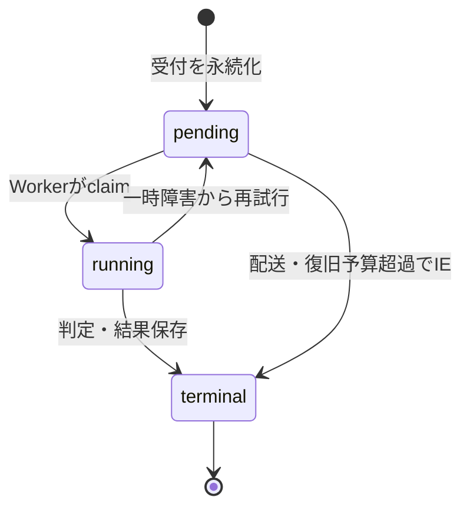

# 競技プログラミングサービスのプロダクト設計

[Issue #25](https://github.com/tagokoro/tag-judge/issues/25) の設計。Problem・TestCase・Submissionをサービスの中心に置き、CodeRunを提出前の動作確認として提供する。隔離実行はこのサービスを支える内部基盤とする。構成は [インフラ設計](infrastructure-design.md)、技術選定は [ADR-0001](adr/0001-competitive-programming-service.md) を参照する。

本書は現在の機能と今後の目標を区別する。実装の起点はmain `f8f5e0c`。この文書の追加だけで画面・言語・隔離保証が実装されるものではない。

## 1. 利用者と最初の到達点

| 利用者 | できること |
| --- | --- |
| 解答者 | 問題を読む、コードを試す、提出する、自分の判定結果と履歴を確認する |
| 作問者 | 問題文・実行制限・テストケースを登録し、問題を公開する |
| 管理者 | 問題・ユーザー権限・判定基盤を運用し、判定障害を調べる |

最初の実装単位は、公開問題を解いて提出・結果確認できる練習サイトとする。コンテストも競プロサービスの拡張対象だが、開催期間・参加登録・順位表・ペナルティ等は別途仕様を定める。Groupは既存のデータとAPIを維持し、コンテストの代わりに流用しない。

まずLocalStack環境で次の導線をつなぐ。

1. 作問者が非公開の問題とテストケースを作成し、公開する。
2. 解答者が問題一覧から問題文・サンプル・制限を確認する。
3. 必要に応じてCodeRunで自分の入力を試す。
4. ログインして解答を提出し、待機中・判定中の状態を見る。
5. AC/WA/TLE/RE等とケース別の時間・メモリを確認し、修正して新しく提出する。

Pythonでこの導線を先に完成させ、追加言語はC++（#5）を優先し、Rust（#4）を続ける。コンパイル言語の追加ではcompile timeoutとCEを定義する。C++が実装されるまで、対応言語はPythonのみと表示する。

## 2. ドメインと公開API

| 概念 | 役割・既存API |
| --- | --- |
| Problem | 問題文・制限・公開範囲。`/api/v1/problems` |
| TestCase | 判定用の入力・期待出力。管理用 `/api/v1/problems/{id}/test-cases` |
| Submission | 特定の問題への解答。`POST /api/v1/problems/{id}/submissions`、`GET /api/v1/submissions/{id}`、自分の一覧 |
| CodeRun | 問題の正誤判定を行わず、コードと任意stdinを一度実行。`/api/v1/code-runs` |
| User / Group | 既存のセッション認証、user/author/admin権限、グループ管理 |

既存エンドポイントと整数ID、作成時201、`data`レスポンスを維持する。新しい `/api/v1/executions` やExecutionテーブルへの統合は導入しない。内部での実行処理の共通化は、利用者向けのドメイン変更と切り離す。

Submissionの作成で受け付けるのはlanguageとsource codeである。判定対象のテストケース・時間・メモリ制限はサーバーがProblemから決め、解答者に指定・上書きさせない。CodeRunの制限はサービス側で固定する。コードや入出力のサイズ上限、同時実行数、保持期限は #28・#30 で文書化・強制する。

問題の一般閲覧・提出は現在publicのみを対象とする。private/groupを利用者に公開するには別の閲覧・提出認可が必要であり、既存のvisibility列だけで完成と扱わない。提出詳細とCodeRun詳細は本人または管理者、自分の一覧は本人だけを対象とする。

## 3. 判定と表示する結果

### Submission

- 既存の `pending / running / ac / wa / tle / mle / re / ce / ie` を維持する。
- Pythonの構文エラーや例外はRE。CEはコンパイル言語向け。
- ケースは現在の順序で実行し、最初の非ACで止める。未実行ケースを成功扱いしない。
- 出力比較は末尾の空白・改行を除いて比較する。Special Judgeは別設計とする。
- 得点は現行どおり全ケースACならケース得点の合計、それ以外は0。部分点・コンテスト得点ルールは別途設計する。
- 詳細はstatus、score、judged_at、case_resultsを返す。case_resultsは実行済みケースのtest_case_id・status・execution_time_ms・memory_kbのみ。待機中・判定中は空配列。
- 未計測値はnull。現行Workerはmemory_kbを保存せず、MLEの検出も未対応のため #28 で接続する。

### CodeRun

- 既存の `pending / running / ac / tle / re / ie` を維持する。
- このacは「正常終了」を意味し、画面では「実行成功」と表示する。正解判定や得点は付けない。
- source_code、stdin、stdout、stderr、execution_time_ms、memory_kbを既存APIで扱う。#27で必要になる終了コード等の追加は、既存フィールドと状態を維持した拡張として設計する。
- 現行APIは受付・dispatchまで実装済み。Rust Workerのstdin処理とCodeRunへの結果保存は未実装である。

### テストケースの公開境界

解答者には問題文に載せたサンプル、または `is_sample=true` だけを返す専用の読み取り機能を使う。現行のtest-cases一覧は作問者・管理者用であり、解答者向け画面から呼び出さない。サンプル表示用のAPI整備は画面実装と合わせて行う。

Submissionの詳細に隠しテストの入力・期待出力・stdout/stderrを返さない。この制約は管理者が同じ詳細APIを使う場合も維持する。CodeRunは本人が与えた入力の実行結果としてstdout/stderrを返す。ソース・入力・出力本文・credentialは運用ログに残さない。

## 4. 状態遷移と再配送

以下は既存状態名を使った目標遷移である。排他的claimと異常復旧は #29 で完成させる。

| 遷移 | 条件 |
| --- | --- |
| 作成 → pending | source保存後、対象レコードとoutboxを同じtransactionでcommitする。Submissionは実装済み、CodeRunは #29 で対応 |
| pending → running | 有効なleaseと試行tokenを取得できたWorkerだけが開始する |
| running → 終端 | 有効な試行だけが結果をtransactionで保存する。Submissionの終端はAC/WA/TLE/MLE/RE/CE/IE、CodeRunはAC/TLE/RE/IE |
| running → pending | 一時障害・lease失効時に古い試行を無効化し、有限の予算内で再試行を予約する |
| pending / running → IE | 復旧不能または再試行予算超過。recoveryも条件付き更新で確定する |

結果保存後にだけSQS messageを削除する。終端レコードの再配送は再判定せずackし、終端状態を過去へ戻さない。再提出は新しいSubmissionを作る。キャンセル・管理画面からの再ジャッジは初期対象外とする。

冪等性の単位は `(reference.kind, reference.id)`（submission/code_runとそのID）。内部のattempt tokenは古いWorkerの結果上書きを防ぐ。物理的な実行の重複は起こり得るため、試行ごとの資源上限とcleanupも必要である。HTTP POST自体の冪等キーとは区別する。

一時的なDB/S3/queue障害を直ちにREやIEとして保存しない。retry上限、visibility/heartbeat、DLQ、stale recovery、poison message、graceful shutdownは #29 で接続する。現行の終端チェック・行ロックだけで実行開始の排他が完成しているとは扱わない。

## 5. 公開要求と内部ジョブの境界

Go APIは認証・問題へのアクセス・制限値を検証し、sourceとテストケースの参照を確定する。S3 keyやqueue messageを解答者に指定させない。SQS jobは内部サービス間の契約とする。

| 内部モード | reference | 入力 | 処理と保存先 |
| --- | --- | --- | --- |
| problem | submission / ID | source artifact、test case snapshot、Problem由来の制限 | ケース実行・比較・集約後、submissionsとsubmission_resultsへ保存 |
| stdin | code_run / ID | source artifact、本人のstdin、サービス側制限 | 一度実行後、code_runsへ保存 |

Go側の `ExecutionJob` とstorage/dispatcherの境界は維持する。Rust Workerは #27 で両モードを判別できるようにし、既存problem jobの `submissionId` 等の互換フィールドを読み続ける。jobのversionを追加する場合は旧consumerを更新してから新producerを有効化し、旧形式を黙って別モードに解釈しない。

WorkerがDB/S3/SQSを扱い、judge-coreには取得済みの入力と制限だけを渡す。runnerは子プロセスの終了、計測、制限違反を返し、problem modeがAC/WA等へ集約する。Workerの認証情報をユーザープロセスへ継承させない。

既存のテストケーススナップショットを使い続ける。判定中の問題編集に対する追加の整合性設計は今回の対象外とする。

## 6. 今後の作業と完了条件

旧「汎用実行API」計画をそのまま実装せず、以下の競プロサービス向けの範囲に読み替える。関連Issueに旧文言が残る場合は着手時にこの仕様へ揃える。

| 優先・Issue | 作業 |
| --- | --- |
| 1. #32 | 問題一覧・詳細・サンプル・提出フォーム・結果・履歴の利用者画面、作問導線、READMEとローカル手順。作問画面に不足する管理用取得APIも確認する |
| 2. #27 | CodeRunのstdin Workerと結果保存を完成し、動作確認画面へ接続 |
| 3. #5、続いて #4 | C++、その後Rustのcompile/run、CE・compile timeout・対応言語表示 |
| 並行して #28 | Problem/CodeRun由来の制限をrunnerへ接続。memory・output・process・filesystem・network・環境変数・cleanupの試験 |
| 並行して #29 | Submissionの既存outboxを土台にCodeRunも回復可能にし、lease・再配送・異常復旧を完成 |
| 公開前 #30 | セッション認証と認可、入力・rate・同時実行制限、保持期限、CORS、隠しテスト保護 |
| 公開前 #31 | Linux実行hostのprivate配置、権限とversion固定、提出ID/CodeRun IDによる監視、E2E、deploy/rollback/runbook |
| #26 | 汎用execution APIへの移行は今回の計画から外す。既存CodeRunを使う |
| #33 | 全体の到達点を競プロサービスの利用フローで管理する |

LocalStackでの最初の完了条件は、作問・公開→問題閲覧→Python提出→AC/WA/TLE/REとケース詳細の取得が画面から再現できること。CodeRunはそれに続く動作確認機能として完成させる。公開サービスには #28〜#31 の検証と運用準備を加える。非Linuxのdirect runnerで未信頼コードの安全性を検証したとは扱わない。

コンテスト運営・順位表・レーティング、グループ限定の問題閲覧/提出、Special Judge・部分点、対話問題、外部パッケージやネットワーク、複数ファイルのIDE、公開SDK/API key、汎用execution APIは初期実装の範囲外とする。必要になった機能から別の仕様として追加し、競プロサービスを主軸とする方針は維持する。
