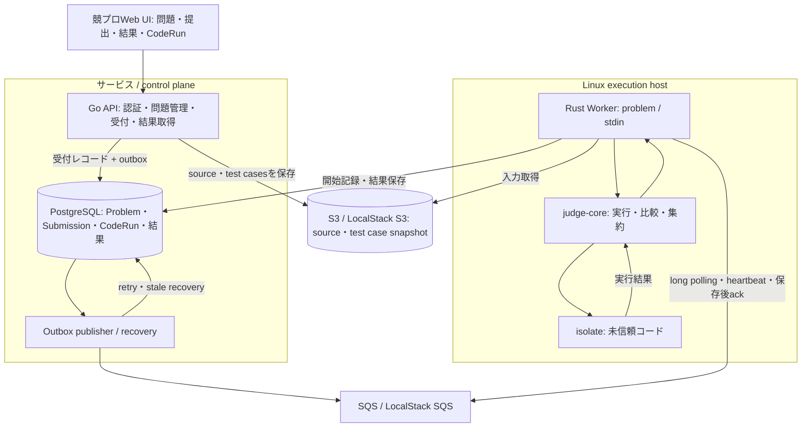

# 競プロサービスのインフラ構成

Problem・Submissionを中心にした競技プログラミングサービスを構築する。CodeRunは任意入力による動作確認、隔離実行基盤は問題判定とCodeRunを支える内部実装とする。[プロダクト設計](competitive-programming-service.md) と [ADR-0001](adr/0001-competitive-programming-service.md) を基準にする。

## 目標構成

図は利用者画面とCodeRun Worker、復旧機能を含む目標構成である。現在の実装範囲は後述する。

APIは提出をpendingで受け付け、UIがSubmission IDで判定状況を取得する。CodeRunも同様に自分のIDで実行結果を取得する。DBを状態と結果の正とし、Workerは結果保存後にSQS messageを削除する。

WorkerはDB/S3/SQSへ接続する信頼済みサービスである。未信頼の子プロセスへcredential、ホストの秘密ファイル、他実行の作業領域を渡さない。CPU/wall/memory/output/process等の制限と外部network禁止を #28、配置と最小権限を #31 で検証する。

## 環境

| 要素 | LocalStackでの検証 | AWSでの目標 |
| --- | --- | --- |
| Web UI / Go API | ローカルプロセス | Web/API配置は #31 で確定 |
| PostgreSQL | Docker ComposeのPostgreSQL 16 | privateなPostgreSQL。運用方式は #31 |
| Queue / DLQ | LocalStack SQS | Amazon SQS |
| Artifact | LocalStack S3 | Amazon S3 |
| Rust Worker / isolate | Linux hostまたはVM | private network上のLinux EC2 |

LocalStackはAWS adapterを検証する環境であり、隔離実行の検証はLinux上で行う。macOSのdirect runnerは信頼できる開発コード用とする。[ローカル開発手順](local-development.md) を参照する。

Go APIと既存AWS adapterを継続使用する。Cloudflareへの移行は利用者向け機能の前提とせず、必要になった段階で再評価する。技術的な境界と比較は [ADR](adr/0001-competitive-programming-service.md) に残す。

## mainの実装状況

起点はmain `f8f5e0c`。

| 領域 | 実装済み | 残る作業 |
| --- | --- | --- |
| 問題・認証 | セッション、Problem/TestCase管理、公開問題の一覧・詳細、Group管理 | 利用者/作問者の画面、解答者向けサンプル表示 |
| Submission | S3参照、DB/outboxの同時commit、publisher、Workerの判定・得点・ケース保存、本人/管理者の詳細API | 画面、制限・計測の強化、異常復旧 |
| CodeRun | API受付、S3 source保存、stdin jobの直接dispatch | #27 Worker処理・DB保存、#29 outboxと復旧 |
| 配送 | long polling、visibility延長、終端Submissionの再配送skip | #29 lease/fencing、stale、DLQ/poison、graceful shutdown |
| runner | Python、isolate、時間制限と固定メモリ上限 | #28 Problemのmemory制限接続、計測、出力等の制限、#5 C++ |
| 公開準備 | TerraformとCI、EC2 Worker向け構成 | #30/#31 利用制御、private配置、E2E、監視 |

問題の一般閲覧と提出はpublicに限定される。private/groupの利用者向け閲覧・提出、コンテスト、順位表は実装済みと扱わない。Submission詳細は隠しテストの入力・期待出力・stdout/stderrを公開しない。

Rust内部は [Worker設計](rust-judge-design.md)、比較・判定の規則は [judge-core要件](judge-core-requirements.md)、今後の優先順は [プロダクト設計](competitive-programming-service.md#6-今後の作業と完了条件)、Terraform手順は [CI/CD](terraform-cicd.md) を参照する。
