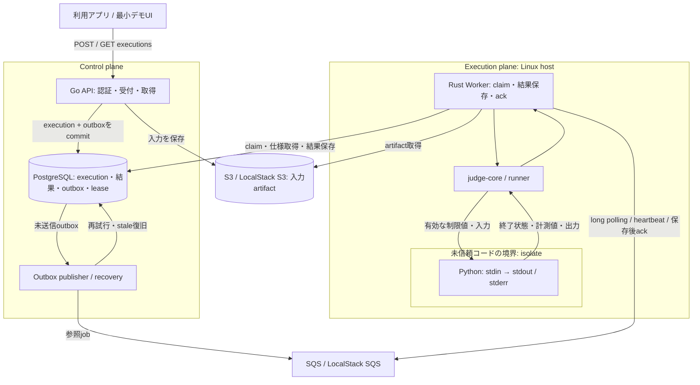

# インフラ構成と実装状況

プロダクトの中心は、Pythonコードとstdinを受け取り、隔離実行の結果を非同期に取得するAPIである。[プロダクト境界・実行モデル](sandbox-execution-api.md) を契約の基準とし、技術選定は [ADR-0001](adr/0001-sandbox-execution-api.md) に記録する。

## 目標構成

次の図は #25 で定義する目標構成である。新execution API、lease/recovery、公開向け隔離設定がすべて実装済みであることを示すものではない。

APIとWorkerは独立して起動する。HTTPリクエストを実行完了まで待たせず、クライアントはexecution IDで状態を取得する。queueは通知の搬送路、DBが受付状態と確定結果の正となる。WorkerはDBへ直接結果を保存し、保存成功後にmessageを削除する。

execution planeでは、隔離境界の外側にいるWorkerだけがクラウド・DBのcredentialを持つ。子プロセスにはallowlistの環境変数と必要なruntimeだけを渡し、ホストのファイルや外部ネットワークへアクセスさせない。設定と検証は #28、配置とサービス権限は #31 で完成させる。

## 環境ごとの配置

| 要素 | 最初の検証環境 | AWSでの目標 |
| --- | --- | --- |
| Go API / publisher | ローカルのGoプロセス | API用host。具体的な配置は #31 で確定 |
| PostgreSQL | Docker ComposeのPostgreSQL 16 | privateなPostgreSQL。RDS等の運用方式は #31 |
| Queue / DLQ | LocalStack SQS | Amazon SQS |
| Artifact | LocalStack S3 | Amazon S3 |
| Rust Worker / isolate | Linux hostまたはLinux VM | private network上のLinux EC2 |

macOSのdirect runnerは信頼できる開発コードの動作確認用であり、隔離の代替ではない。LocalStackはAWS adapterを試す環境で、sandbox自体はLinuxで検証する。起動方法は [ローカル開発手順](local-development.md) を参照する。

Cloudflareは将来のcontrol plane候補とする。通常のWorkersに現在のLinux isolate実行を移すことは想定せず、別の実行サービスを評価する場合も公開契約と隔離試験を維持する。比較と根拠は [ADR](adr/0001-sandbox-execution-api.md) にまとめている。

## 現行mainの到達点

以下はこの設計の起点であるmain `f8f5e0c` の実装状況。

| 領域 | 実装済み | 後続作業 |
| --- | --- | --- |
| Go API | セッション認証、Problem/Submission/CodeRun、Submission詳細のケース別結果 | #26 execution APIとCodeRun互換処理 |
| Submission受付 | S3ソース・テストケーススナップショット、DB/outboxの同時commit、publisherの再試行 | #29 汎用executionへの適用と復旧保証 |
| CodeRun受付 | DB登録、S3ソース保存、stdin jobの直接dispatch | #26/#29 outbox化。保存・dispatch失敗時のpending滞留を解消 |
| Rust Worker | problem job受信、S3取得、判定・得点・ケース結果をDB保存後ack | #27 stdin jobと共通結果モデル |
| 配送 | SQS long polling、visibility延長、終端Submissionの再配送をskip | #29 lease/fencing、stale回復、poison/DLQ、graceful shutdown |
| 実行 | Python、Linux isolate、時間制限、固定のメモリ上限 | #28 要求ごとの制限、出力・process等の制限、peak計測、攻撃的試験 |
| 運用 | TerraformとCI、EC2 Worker向け構成 | #30/#31 公開に必要な利用制御・private配置・E2E・監視 |

汎用executionの状態名を、そのまま現行Submission/CodeRunの状態名として扱わない。旧APIの `pending / ac / re / tle / ie` と新しい `queued / succeeded / failed / timed_out` の対応は [移行契約](sandbox-execution-api.md#7-既存機能の維持と移行) を参照する。

## サンプルアプリとの関係

Problem/Submissionは既存の問題判定を維持するサンプルである。期待出力比較・得点・AC/WAはproblem modeに閉じ込め、実行APIの利用に必須としない。Rust内部の責務は [Rust設計](rust-judge-design.md)、problem modeの判定規則は [judge-core要件](judge-core-requirements.md) に記載する。

新規の実装順序と各Issueの境界は [後続Issue一覧](sandbox-execution-api.md#8-後続issueの実装境界と対象外) に集約する。TerraformのCI手順は [Terraform CI/CD](terraform-cicd.md) を参照する。
