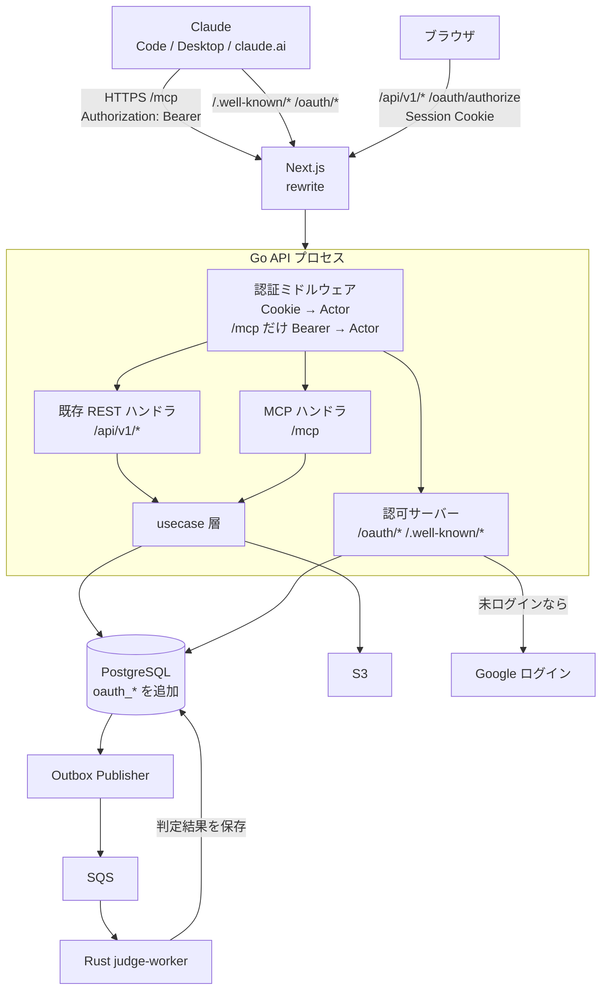
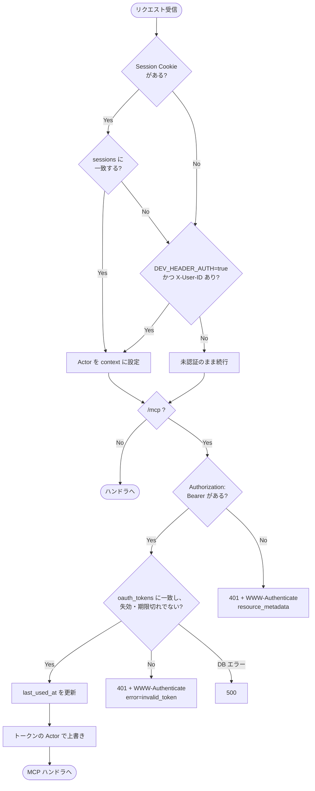
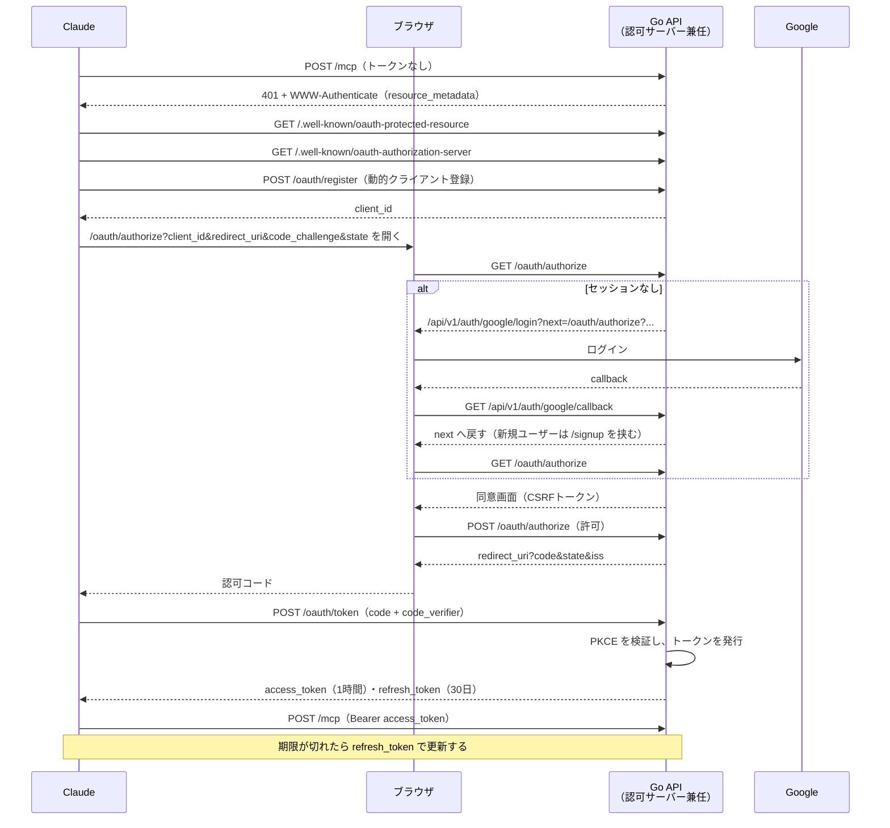
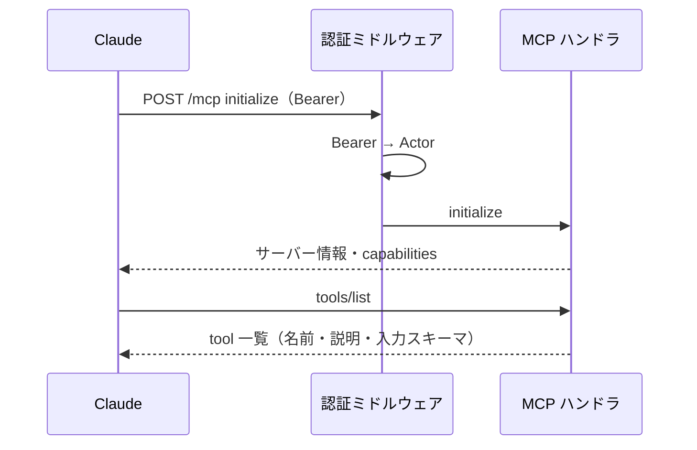
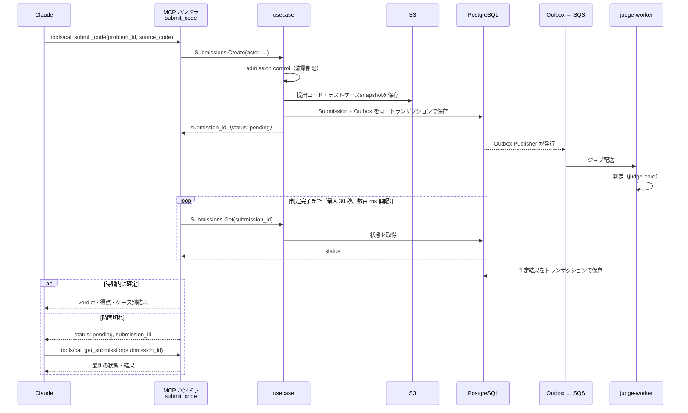
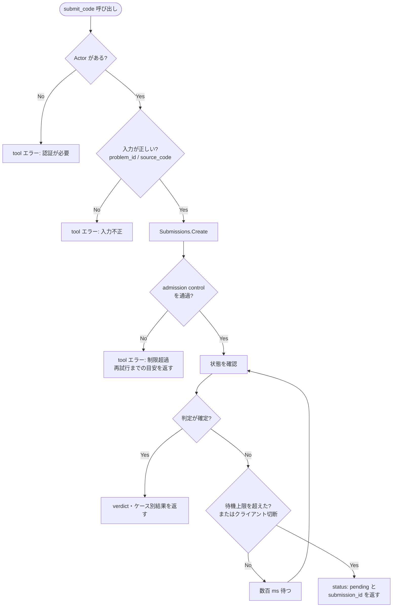

# MCP Server Design

Claude（Claude Code / Desktop / claude.ai）からTag Judgeの問題閲覧・作成、コード提出・結果取得を行うためのMCPサーバーの設計です。

**実装状況:** `/mcp`、閲覧・作成・提出のtool、OAuth 2.1の認可サーバーは実装済みです。`run_code` と、接続済みアプリの一覧・解除の画面は未実装です。

## 方針

- MCPサーバーは別プロセスにせず、Go APIに `/mcp` ルート（Streamable HTTP）として同居させる。
- toolは既存のusecaseを直接呼ぶ。HTTP APIを経由しない。
- 認証はOAuth 2.1で行う。Go APIが認可サーバーを兼ね、ログインには既存のGoogleログインを使う。claude.ai・Claude Desktop・Claude Codeのどれも、URLを登録するだけで接続できる。
- ブラウザから見えるURLはフロントのオリジンに揃える。`/mcp`、`/oauth/*`、`/.well-known/oauth-*` はNext.jsのrewriteでGo APIへ転送する。こうすると同意画面が、セッションCookieを持つオリジンで開く。

## 全体構成



## 使い方

ユーザーは、Claudeに `https://<フロントのドメイン>/mcp` を登録するだけです。

- **claude.ai / Claude Desktop**：設定 → コネクタ → カスタムコネクタを追加 → URLを入力 → 接続
- **Claude Code**：`claude mcp add --transport http tag-judge https://<ドメイン>/mcp` を実行し、`/mcp` から認証する

接続するとブラウザで同意画面が開きます（未ログインならGoogleログインを挟みます）。「許可」を押すと接続が完了します。

### ローカルで試す

```sh
set -a; source .env; set +a; make run-api   # 別ターミナルで make run-frontend も起動する
claude mcp add --transport http tag-judge http://localhost:3000/mcp
# Claude Code で /mcp → tag-judge → Authenticate
```

claude.ai はAnthropicのサーバーから接続するため、`localhost` には届きません。デプロイ先か、トンネル（cloudflared など）で公開したURLを使ってください。

### 設定

| 環境変数 | 説明 |
| --- | --- |
| `PUBLIC_BASE_URL` | ユーザーとClaudeがアクセスするオリジン。OAuthのissuerで、その `/mcp` がMCPのURLになる。省略すると `AUTH_SUCCESS_REDIRECT_URL` のオリジンを使う |
| `MCP_SUBMIT_WAIT_SECONDS` | `submit_code` の待機上限（既定8秒）。`WRITE_TIMEOUT`（既定10秒）以上にすると起動時にエラーになる |

### エンドポイント

| エンドポイント | 説明 |
| --- | --- |
| `POST /mcp` | MCP（Stateless・JSON応答のStreamable HTTP）。トークンがないと `401` と `WWW-Authenticate: Bearer resource_metadata="..."` を返す |
| `GET /.well-known/oauth-protected-resource`（`/mcp` 付きも可） | 保護リソースのメタデータ（RFC 9728） |
| `GET /.well-known/oauth-authorization-server` | 認可サーバーのメタデータ（RFC 8414） |
| `POST /oauth/register` | 動的クライアント登録（RFC 7591）。public client（`none`）と、`client_secret_post` / `client_secret_basic` に対応 |
| `GET /oauth/authorize` | 同意画面。PKCE（S256）は必須。未ログインならGoogleログインへ送り、ログイン後に戻す |
| `POST /oauth/authorize` | 同意フォームの送信先（CSRFトークンつき） |
| `POST /oauth/token` | `authorization_code` と `refresh_token` のgrant |

- 認可コードは5分、アクセストークンは1時間、リフレッシュトークンは30日で失効する。
- リフレッシュするたびにトークンの組を作り直す。古いアクセストークンとリフレッシュトークンは、その時点で使えなくなる。
- 認可コードとトークンは、DBにはSHA-256ハッシュだけを保存する。アクセストークンは `tja_`、リフレッシュトークンは `tjr_` で始まる。
- `redirect_uri` は登録済みのものと完全一致で照合する。登録できるのは、https のURL、ループバック（`localhost` など）上の http のURL、アプリ独自のスキーム（Cursor の `cursor://...` など。RFC 8252）。`javascript:` や `file:` などブラウザが自分で扱うスキームは拒否する。
- 同意できるのはブラウザのセッションだけ。同意画面は `X-Frame-Options: DENY` で、iframeへの埋め込みを禁止している。
- `/mcp` はブラウザのセッションCookieを受け付けない。ブラウザで開いたページから、ユーザーのCookieでtoolを動かされないようにするため。
- `/mcp` をブラウザで開いた人（`Accept: text/html`）は、Next.jsのredirectで接続手順のページ（`/connect`）へ送る。MCPクライアントはHTMLを求めないので影響しない。
- 新規ユーザーがClaudeから接続した場合は、ハンドル登録（`/signup`）を挟んでから同意画面に戻る。

## tool一覧

`/mcp` を使うには接続（OAuth）が必要です。toolはすべて、接続を許可したユーザーとして動きます。

| tool | usecase | 必要な権限 |
| --- | --- | --- |
| `list_problems` | ListPublicProblems（`mine=true` で ListMyProblems） | なし |
| `get_problem` | GetProblem | 非公開の問題は管理者だけ |
| `create_problem` | CreateProblem（visibility の既定は private） | author / admin、ハンドル登録済み |
| `update_problem` | UpdateProblem（公開もこれで行う） | 問題の管理者 |
| `list_test_cases` | TestCases.List | 問題の管理者 |
| `add_test_case` | TestCases.Create | 問題の管理者 |
| `submit_code` | Submissions.Create（判定完了まで上限つきで待つ） | なし（提出の流量制限あり） |
| `get_submission` | Submissions.Get | 非公開の提出は本人だけ |
| `run_code` | CodeRuns.Create（Workerが対応するまで公開しない） | 未実装 |

## 認証ミドルウェアの判定フロー



- Bearerを受け付けるのは `/mcp` だけ。トークンで許すのはMCPのtoolでできる操作に限るため、REST API（`/api/v1/*`）ではBearerを見ない。
- 不正なBearerは401で拒否する。Claudeがトークンの更新か再認証を始められるようにするため。
- トークンの照合でDBが失敗したときは500を返す。401を返すと、一時的な障害で全クライアントが再認証を始めてしまう。
- `/mcp` はセッションCookieを受け付けない。ブラウザで開いたページが、利用者のCookieでtoolを動かせないようにするため。

## ① 接続（OAuth）



## ② MCPの初期化



## ③ 提出から判定結果まで



## submit_code の内部フロー



- 待機の上限は、サーバーの `WRITE_TIMEOUT` とALBのidle timeoutより短くする。
- クライアントが切断したら（`ctx.Done()`）待機をやめる。提出自体はOutbox経由で判定まで進む。

## 今後の予定

1. 接続済みアプリの一覧と解除の画面（`oauth_tokens` をユーザーごとに失効させる）
2. MCP経由のアクセスログと、閲覧系toolのレート制限
3. 動的クライアント登録の流量制限と、使われていないクライアント・期限切れトークンの掃除
4. Workerが対応したら `run_code`
