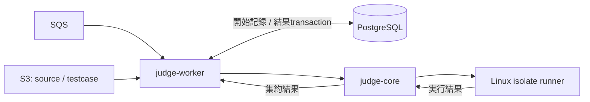

# Rust Workerとjudge-coreの設計

Rustは、未信頼コードの隔離実行とその結果の回収を担当する。プロダクト全体の目標は [サンドボックス実行API](sandbox-execution-api.md)、配置と実装状況は [インフラ設計](infrastructure-design.md) に従う。本書の「現行」はmain `f8f5e0c` 時点を示す。

## 責務

| コンポーネント | 責務 |
| --- | --- |
| Go API | 認証、入力検証、artifact保存、受付とoutbox、公開APIでの結果取得 |
| judge-worker | queue受信、DBでの開始記録、artifact取得、core呼び出し、DBへの結果保存、保存後ack |
| judge-core | Python実行、時間計測、制限超過の検出。problem modeでは期待出力比較とverdict集約 |
| runner | 実行環境の準備、子プロセス起動、入出力回収、停止・cleanup |

WorkerはPostgreSQLへ直接アクセスする。core/runnerはDB、SQS、S3を知らず、Workerから取得済みの入力を受け取る。CLIはcoreを単独検証する入口として維持する。MVPでは別のResult Consumerは設けない。



## 現行のproblem mode

API側の `ExecutionJob` はreference（submission/code_run）とexecutionMode（problem/stdin）を持つ。ただし現行Rust Workerの `JudgeJob` は次のSubmission向けフィールドを読むため、APIはproblem jobに互換フィールドも含めている。

```text
submissionId
language
sourceCodeKey
testCasesKey
timeLimitMs
```

Submissionのソースとテストケースは提出時にS3へ保存する。APIはSubmissionとoutboxを同じDB transactionで作り、publisherがSQSへ配送する。WorkerはS3からスナップショットを取得し、coreの `JudgeRequest` に変換する。

coreはPythonをケースごとに実行し、末尾の空白・改行を除いた出力を比較する。最初の非ACで止まり、実行したケースだけを返す。Pythonの構文エラーや例外はRE。WA、得点、複数ケースの集約はproblem mode固有であり、stdin executionには適用しない。詳細は [judge-core要件](judge-core-requirements.md) に残す。

Workerは `submissions` と `submission_results` へ判定・ケース結果・得点を一つのtransactionで保存し、その後にSQS messageを削除する。DB/S3の一時障害は再配送の対象とし、終端Submissionの再配送では再判定しない。visibilityは判定中に延長する。ただし現在の行ロックと終端チェックだけでは、複数Workerの実行開始をleaseで排他する仕組みにはなっていない。

## stdin modeで追加するもの

現行CodeRun APIはpendingレコードを作り、ソースをS3へ保存してstdin jobを直接dispatchする。source保存やdispatchの失敗時にpendingをrollbackせず、現行Rust Workerもstdin jobを処理できない。

#26〜#29で、CodeRunを汎用executionの互換入口へ移し、次を実装する。

1. version別jobを読み分け、problem modeを維持しながらstdin modeを受け付ける。
2. executionをclaimし、DBの不変な実行仕様からソース・stdin・有効な制限値を取得する。
3. test casesや期待出力を要求せず、runnerを一度呼ぶ。
4. ユーザープロセスの終了コード、出力、wall clock時間、peak memory、安定したfailure reasonを保存する。
5. 有効なattempt tokenに対してのみ終端結果を確定し、DB保存成功後にackする。

状態、nullableな結果値、retry、内部envelopeと互換性は [共通実行モデル](sandbox-execution-api.md) を正とする。現行 `ExecutionOutput` の成功フラグ・runtime・timed_outだけでは新しい結果契約を満たせないため、#27/#28でrunnerのモデルも拡張する。

## 隔離と資源制限

現行Linux runnerはisolateのinit/run/cleanupとboxの排他を扱う。CPU時間は要求値、wall clockは要求値に1秒を加えた値、メモリは固定値で渡している。メモリ使用量は結果に保存しておらず、stdout/stderrを読み込む前の明示的なサイズ制限も完成していない。これらは新APIの目標仕様との差分である。

#28で要求ごとのCPU/wall/memory制限、出力・生成ファイル・process/thread数の制限、環境変数allowlist、filesystemの限定、外部networkの禁止を接続する。ユーザーコードの停止とcleanupを確認してから通常の結果を確定する。Worker死亡時の復旧は #29、host再起動時の残留処理と運用は #31 に接続する。

非Linux環境のdirect runnerは信頼できるローカルコードの確認だけに使う。未信頼コードの保証はLinux上の攻撃的ケース試験で確認する。isolateの導入自体は完了しているが、公開API向けの安全性検証は別の完了条件である。

## 維持する境界

- 公開APIの利用者にS3 keyや内部jobのJSONを渡させない。
- coreへDB接続やqueue SDKを持ち込まない。
- problem modeのAC/WAをexecutionのstatusへ持ち込まない。
- Workerのcredentialを子プロセスに渡さない。
- 旧Submissionの判定・得点・ケース別結果を回帰テストで維持する。

追加言語とcompile stepは #4/#5 のMVP後の作業とする。技術選定の理由とCloudflare APIとの将来の関係は [ADR-0001](adr/0001-sandbox-execution-api.md) に記録する。
