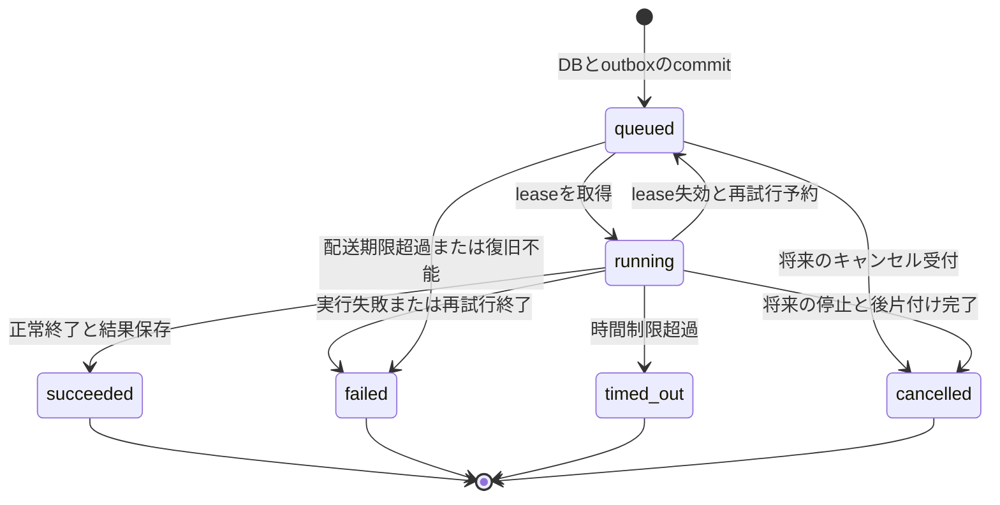

# サンドボックス実行APIのプロダクト境界と実行モデル

この文書は [Issue #25](https://github.com/tagokoro/tag-judge/issues/25) で定義する目標仕様である。API・Workerへの実装は #26〜#31 で行う。現行mainで利用できる機能は [構成と実装状況](infrastructure-design.md)、技術選定は [ADR-0001](adr/0001-sandbox-execution-api.md)、現在の起動方法は [ローカル開発手順](local-development.md) を参照する。

## 1. プロダクトとMVP

利用者がPythonソースと標準入力を送信すると、Linuxの隔離環境で一度実行し、保存された終了状態・標準出力・標準エラー・実行時間・メモリ使用量を取得できる非同期APIを中心とする。問題、正解データ、提出先の作成は不要である。

| 利用者 | MVPで支える利用例 | アプリ側の責務 |
| --- | --- | --- |
| プログラミング教材の開発者 | 学習者のコードに入力を与え、結果を表示する | 教材・学習進捗・正誤判定 |
| 採用試験の開発者 | 解答コードを隔離実行する | 試験、採点、受験者管理 |
| オンラインIDEの開発者 | 実行ボタンからコードを送り、完了後に出力を表示する | エディタ、ファイル編集 |
| 生成コード検証ツールの開発者 | 生成したコードを固定入力で試す | コード生成、結果の評価 |

MVPはPython標準ライブラリを使う、非対話の短時間実行に絞る。利用者は認証済みユーザーであり、初期は既存のセッション認証を使う。API keyの採否は公開デモ前の #30 で決める。任意の長時間プロセスや一般用途の開発コンテナは提供しない。

LocalStackで受付から結果取得まで完走することを最初の到達点とする。ただし未信頼コードの受け入れにはLinux/isolateによる #28 の検証が必要で、macOS上のdirect runnerは信頼できる開発用コードに限る。外部公開にはさらに #30・#31 の完了が必要である。

## 2. 責務と信頼境界

| 層 | 責務 | 扱わないもの |
| --- | --- | --- |
| 公開API / control plane | 認証・所有者認可、入力検証、制限値決定、artifact保存、executionとoutbox作成、状態・結果取得 | ユーザーコードの実行、クライアント指定のS3 keyやqueue宛先 |
| Dispatcher / recovery | outbox配送、再試行、期限切れleaseの回収、最終失敗の確定 | ユーザーコードの意味・出力の正誤判定 |
| Rust Worker / execution plane | job検証、claim、artifact取得、runner呼び出し、結果保存、保存後のack | ユーザー認証、問題管理、公開HTTP API |
| judge-core / runner | 1回の隔離実行、制限適用、結果計測。problem modeでは追加で比較・集約 | DB、SQS、S3、ユーザー管理 |
| PostgreSQL / object storage | DBを状態・結果・有効な試行の正とし、storageは入力artifactを保持 | queueの配送回数を実行状態の正にすること |

Worker自体は信頼するサービスであり、必要なDB・SQS・S3権限を持つ。未信頼の子プロセスにはこれらのcredentialを渡さない。外部ネットワーク、ホストの秘密ファイル、他実行の作業領域へのアクセスを禁止する。許可するruntime、環境変数、filesystem、process数、生成ファイルの上限を固定し、作業領域を実行ごとに作成・破棄する。具体設定と攻撃的ケースの試験は #28、private networkと最小権限の配置は #31 が担う。

## 3. 公開APIと要求

以下は新規に実装する契約であり、現在のOpenAPIに実装済みという意味ではない。

| 操作 | エンドポイント | 成功時 |
| --- | --- | --- |
| 作成 | `POST /api/v1/executions` | `202 Accepted`、`Location: /api/v1/executions/{id}`、queuedのexecution |
| 取得 | `GET /api/v1/executions/{id}` | `200 OK`、現在のexecution |
| 自分の一覧 | `GET /api/v1/executions?limit=20&offset=0` | `200 OK`、作成日時降順。同時刻はID順で固定 |

単体レスポンスは既存APIと同じ `{"data": ...}` 形式とする。一覧は `data` 配列と `pagination`（limit、offset、total）を返す。limitは1〜100、省略時20、offsetは0以上とする。詳細取得は所有者本人または管理者、一覧はログインユーザー本人の実行だけを対象にする。未認証401、権限不足403、対象なし404とし、入力不正400、サイズ超過413、容量・rate limit超過429は既存の共通エラー形式を使う。429には `Retry-After` を付ける。

作成要求の例:

```json
{
  "language": "python",
  "source_code": "print(sum(map(int, input().split())))\n",
  "stdin": "1 2\n",
  "time_limit_ms": 1000,
  "memory_limit_kb": 65536
}
```

| フィールド | 契約 |
| --- | --- |
| `language` | 必須。MVPは `python` のみ |
| `source_code` | 必須。空文字・空白だけのソースを拒否 |
| `stdin` | 省略時は空文字。渡した改行・空白を保持 |
| `time_limit_ms` | 100〜5000の整数。省略時5000 |
| `memory_limit_kb` | 16384〜262144の整数。省略時262144。単位はKiB |

sourceとstdinはそれぞれUTF-8で64 KiB以下とする。JSON decode前にもHTTP bodyを制限する。timeは子プロセスのCPU時間とwall clock時間の両方に同じ上限を適用し、queue待機・artifact取得・sandbox準備を含めない。memoryは実行に属するプロセス群の上限である。上限超過要求は黙って補正せず受付前に拒否する。サーバー設定で上限を下げる場合も、受付時に確定した有効値をDBに保存し、再試行中に変更しない。

stdoutとstderrはそれぞれ生のbytesで64 KiBを上限とし、超過時はプロセスを終了して `output_limit_exceeded` にする。保存するのは上限内の先頭部分のみ。通常の出力はtrimせず、UTF-8で表現できないbytesは置換文字にする。置換後の文字列もUTF-8で64 KiB以内の文字境界で切る。入力と制限の検証は #26、runnerへの制限適用は #28、HTTP全体の上限・rate limit・保持期限の運用設定は #30 が実装する。

ID、owner、status、artifact key、execution mode、queue設定はクライアントに指定させない。POST自体の冪等キーはMVPでは提供しないため、HTTP再送は別executionを作る場合がある。queue再配送に対する冪等性とは区別する。

## 4. 共通結果モデル

完了後の取得例:

```json
{
  "data": {
    "id": "88801aa9-d562-4ddf-bbb2-e6f74e024adb",
    "language": "python",
    "time_limit_ms": 1000,
    "memory_limit_kb": 65536,
    "status": "succeeded",
    "exit_code": 0,
    "stdout": "3\n",
    "stderr": "",
    "execution_time_ms": 12,
    "memory_kb": 8192,
    "failure_reason": null,
    "created_at": "2026-10-05T10:00:00Z",
    "started_at": "2026-10-05T10:00:01Z",
    "completed_at": "2026-10-05T10:00:01.012Z"
  }
}
```

- `id` はサーバー生成UUID文字列。公開モデルと内部ジョブで同じexecution IDを使う。
- `exit_code` はユーザープロセスの終了コード。isolateコマンド自身の終了コードを流用しない。signal終了・起動前失敗など、終了コードがない場合はnull。
- `execution_time_ms` は最終試行の子プロセスのwall clock実行時間。queue待機や再試行の累計時間は含めない。`memory_kb` は同試行のプロセス群のpeak使用量をKiBで表す。
- 未開始・未計測の数値はnull。計測不能を0で埋めない。Linuxで通常終了した実行の時間・メモリを取得できることは #28 の完了条件とする。
- queued/runningでは `stdout`・`stderr` は空文字、結果数値と `failure_reason`・`completed_at` はnull。出力のストリーミングや途中結果は返さない。
- `created_at` は受付時、`started_at` は最初のclaim時（未開始ならnull）、`completed_at` は終端結果の保存時。再試行でもcreated/startedは保持する。時刻はUTCのRFC 3339形式。
- 制限違反がなければ、stderrが空でなくてもexit codeが0なら成功である。期待出力の比較や `WA` はこのモデルに含めない。
- sourceとstdinは新APIの結果には返さない。結果のstdout/stderrは所有者と管理者だけに公開し、ログにはsource・stdin・出力本文・credentialを残さない。

### 状態とfailure reason

| status | 意味 | failure_reason |
| --- | --- | --- |
| `queued` | 永続化済みで、実行可能な試行の開始待ち | null |
| `running` | Workerが有効なleaseを取得し、準備・実行・結果保存を処理中 | null |
| `succeeded` | 制限違反がなく、ユーザープロセスが0終了 | null |
| `failed` | ユーザーコードの失敗、復旧不能または再試行を終えた基盤障害 | 下表の理由 |
| `timed_out` | 子プロセスのCPUまたはwall clock上限を超過 | `time_limit_exceeded` |
| `cancelled` | 明示的なキャンセルにより実行を終了した | `cancelled` |

| failedの理由 | 条件 |
| --- | --- |
| `runtime_error` | 非0終了・signal終了。Pythonの構文エラーも含む |
| `memory_limit_exceeded` | runnerがメモリ上限超過を確認 |
| `output_limit_exceeded` | stdoutまたはstderrが上限超過 |
| `resource_limit_exceeded` | runnerがその他のprocess数・生成ファイル等の制限違反を確認 |
| `infrastructure_error` | 不正な内部artifact、sandbox準備失敗、または再試行・配送期限を使い切った基盤障害 |

OSから単に拒否されユーザー例外になった操作は `runtime_error` となり得る。確認できない制限違反を推測しない。複数の理由を確認した場合は、結果を信頼できない基盤障害、output超過、memory超過、time超過、その他resource超過、runtime errorの順に分類する。利用者に内部のパスやcredentialを含むエラーを返さず、詳細診断はexecution IDで内部ログと結び付ける。

## 5. 状態遷移と配送



表と図にない遷移は禁止する。結果と終端状態は同じDB transactionで保存する。

| 遷移 | 更新条件・担当 |
| --- | --- |
| 作成 → queued | APIが入力artifactの保存に成功し、executionとoutboxを同時commitした後だけ202を返す。失敗時は受付不成立。孤立artifactはcleanup対象 |
| queued → running | Workerが条件付き更新でleaseと新しいattempt tokenを取得した1試行だけ。準備開始前に記録 |
| running → succeeded / failed / timed_out | 有効なattempt tokenを持つWorkerが子プロセスの停止と後片付けを確認し、結果を保存 |
| running → queued | 一時障害またはlease失効時にrecoveryが古いtokenを無効化し、再試行予算が残る場合だけoutboxを再作成 |
| queued / running → failed | 復旧不能またはretry/dispatch期限超過。recoveryも条件付き更新し、runningなら古い試行をfenceする |
| queued → cancelled | 将来のキャンセル機能が未claimの行を条件付き更新 |
| running → cancelled | 将来のキャンセル機能で停止要求を記録し、実行停止・後片付けとtoken無効化を確認した後に確定 |

`cancelled` は共通モデルの予約済み終端状態とする。#26のMVPにキャンセル操作は含めず、MVPでは発生しない。将来、停止要求中はrunningのまま扱い、成功結果との競合は先に条件付きcommitできた終端状態を採用する。Workerのshutdownやlease失効をキャンセル扱いにしない。

終端状態は変更しない。再実行は新しいexecution IDを作る。終端IDの再配送は結果を変更せずackし、別Workerが有効なleaseを持つ場合は実行を開始しない。SQSのvisibility延長だけに排他を依存せず、期限切れWorkerによる古い結果の上書きをattempt tokenで拒否する。

結果のDB保存に失敗したときはackしない。一時的なS3/DB/queue障害を直ちにユーザーコードの失敗として確定しない。retry回数と配送期限はDBで管理し、SQS receive countと区別する。有限のretry予算・lease/heartbeat間隔・stale検出・DLQ運用は #29 で設定し、queued/runningが無期限に残らないことを試験する。壊れたmessageはDLQへ退避し、関連executionが判別できない場合もrecoveryがDB側の滞留を解消する。

この設計は結果の一度だけの確定を保証する。Worker停止や通信断では物理的な実行の重複が起こり得る。fencingはDB更新を防ぐ仕組みであり、古い子プロセスを直接停止する仕組みではないため、各実行の上限とWorker側のcleanupも必要である。

## 6. 内部ジョブと保存モデル

公開要求にはコード本文と利用者の指定値を受け付ける。内部ジョブには認可済み・受付済みexecutionへの参照だけを載せ、WorkerはDBの不変な実行仕様からartifact keyと有効な制限値を読む。公開APIから内部ジョブを直接投入させない。

新規execution用のversion 2 envelope:

```json
{
  "schemaVersion": 2,
  "reference": {
    "kind": "execution",
    "id": "88801aa9-d562-4ddf-bbb2-e6f74e024adb"
  },
  "executionMode": "stdin"
}
```

| 内部データ | 所有する情報 |
| --- | --- |
| ExecutionSpec（受付後不変） | ID、owner、language、source/stdin artifact key、有効な制限値、適用したsandbox policyのversion |
| ExecutionRecord | status、結果、日時、retry予算、dispatch期限、lease、attempt token |
| ExecutionOutbox | 一意な配送対象とjob、送信状況、次の試行時刻 |
| RunnerRequest / RunnerResult | Workerが取得した入力本文と有効な制限値 / stdout・stderr・終了コード・計測値・制限違反。DBやS3 keyは渡さない |

source/stdinはexecutionごとのkeyで一度保存し、再試行でも同じ内容を使用する。未知のschemaVersion、mode/referenceの組み合わせ、存在しない参照は通常実行に流さない。DB保存先をmessageに指定させず、受け取ったIDからserver側で解決する。

既存のversion指定がないjobをversion 1として扱う。problem jobの `submissionId` 等の互換フィールドは維持し、#27でversion 1のproblem/stdinとversion 2のstdinを判別する。version 1のcode_run参照は対応するexecutionへ一度だけ関連付け、以後同じIDを使う。既に関連付け済みならmessage中の入力・制限値でDBの仕様を上書きしない。旧pending CodeRunの復旧・未送信レコードの探索は #29 が担当する。

旧pendingを移行するときはDBに保存されたsource/stdin/languageを再検証してartifactを作り、旧API用のサーバー制限値を一度だけ確定する。旧recordに保存されていない制限値をqueue payloadだけで信頼しない。新しい上限に適合しない旧要求は実行せず `infrastructure_error`（旧APIではie）として記録する。Workerを先に対応させ、次に新producerを有効化する。未知のjobを受けた旧Workerへ新jobを配送しないよう、切替時は旧consumerを停止・更新する。

## 7. 既存機能の維持と移行

| 機能 | 方針 |
| --- | --- |
| Problem / TestCase / Submission、既存の得点・ケース別結果 | 既存APIを維持し、実行基盤を利用するサンプルアプリとして位置付ける |
| Group・問題管理・既存の認証認可 | サンプルに必要な既存動作を維持。新しい競プロ機能の拡張はMVP対象外 |
| 問題ごとの期待出力比較、AC/WA等の集約 | problem modeに閉じ込める。汎用executionの状態や正誤判定へ持ち込まない |
| CodeRun API | 互換入口として維持し、新しいexecution処理へ接続する |
| コンテスト、ランキング、問題カタログの拡充 | プロダクトの主目的から外し、新規実装しない |

Problem/Submissionを削除したり、一つのSubmissionを新しいExecutionテーブルへ強制的に統合したりする移行は行わない。runnerと配送・artifactの境界を共有し、problem modeの回帰テストを残す。非公開テストの入力・期待出力・stdout/stderrをSubmission詳細APIへ公開しない。判定中の問題編集への追加対応は今回の対象外とする。

### CodeRun互換契約

`/api/v1/code-runs` の既存の要求フィールド・整数ID・作成201・レスポンスのsource/stdinを維持する。#26で旧IDと新execution IDの一意な対応を保存し、旧APIからの新規作成もexecution/outboxを一つだけ作る。新APIの結果形式を旧エンドポイントへそのまま返す変更はしない。

| 新status | 旧CodeRun status |
| --- | --- |
| queued | pending |
| running | running |
| succeeded | ac |
| timed_out | tle |
| failed / infrastructure_error | ie |
| failed / その他 | re |

cancelledを旧API経由で生成する操作はMVPにはない。キャンセル導入時に旧APIへの写像を別ADRで決める。履歴は既存IDで読めるようにし、終端の旧レコードを移行のために再実行しない。旧データに存在しないexit code・計測値を捏造しない。MVP中は旧APIを削除せず、#32の新規利用例はexecution APIを使う。

## 8. 後続Issueの実装境界と対象外

| Issue | この設計を実装する範囲 |
| --- | --- |
| [#26](https://github.com/tagokoro/tag-judge/issues/26) | ExecutionのDBモデル、作成/取得/一覧、入力検証、OpenAPI、outboxの受付transaction、CodeRun互換adapter |
| [#27](https://github.com/tagokoro/tag-judge/issues/27) | version別job読取、stdinを1回実行、結果保存、保存後ack、problem互換、APIからのintegration test |
| [#28](https://github.com/tagokoro/tag-judge/issues/28) | CPU/wall/memory/output等の制限、failure reason、peak計測、Linuxの隔離・攻撃的ケース試験 |
| [#29](https://github.com/tagokoro/tag-judge/issues/29) | outbox publisher/recovery、条件付きclaimとfencing、retry/DLQ/stale、旧CodeRun復旧、graceful shutdown |
| [#30](https://github.com/tagokoro/tag-judge/issues/30) | 公開用認証、HTTP body上限、rate/concurrency/queue制限、保持期限とcleanup、CORS |
| [#31](https://github.com/tagokoro/tag-judge/issues/31) | Linux host配置、最小権限、version固定、E2E、監視、rollback/runbook |
| [#32](https://github.com/tagokoro/tag-judge/issues/32) | README、起動手順統合、API利用例、正常/異常/timeoutの最小デモUI |

#26と#27はjob・DB契約を共有し、#29で完成する復旧保証を先に「実装済み」と表現しない。#33のMVP完了はPythonの受付→隔離実行→結果取得と #28 の安全性試験で判定する。

MVPでは追加言語（#4・#5）、任意パッケージのインストール、外部ネットワーク、複数ファイルの開発環境、対話実行・TTY・WebSocket、キャンセル操作、利用者からの再ジャッジ、公開webhook、マルチリージョン、大規模autoscalingを扱わない。Cloudflareへのcontrol plane移行は [ADR](adr/0001-sandbox-execution-api.md) の再評価条件を満たしてから判断する。
